# chem-agent

面向计算化学的领域智能体：从 DFT 论文中结构化提取计算参数（泛函、U 值、ENCUT、k 点、表面模型），并把参数转化为可审阅的 VASP 输入草案（INCAR / POSCAR / KPOINTS）。

## 技术栈

Python 3.11 · FastAPI · LangGraph 1.0.9（LangChain 1.2.10）· pymatgen · ChromaDB + sentence-transformers · SQLite（SQLAlchemy async）· DeepSeek（LLM 抽取/兜底/槽位解析）· 前端：React 18 + Vite 5 + TypeScript 5 + Ant Design 5 + React Router 6

## 快速开始

```bash
conda activate chem-agent
pip install -r requirements.txt

# .env 必填：DEEPSEEK_API_KEY、MP_API_KEY
# 可选：HF_ENDPOINT（HuggingFace 镜像）、DEEPSEEK_BASE_URL、DEEPSEEK_MODEL

python scripts/init_db.py

# 启动（模型已缓存在本地时加 HF_HUB_OFFLINE=1，避免 huggingface 不可达时启动卡住）
HF_HUB_OFFLINE=1 uvicorn app.main:app --reload --workers 1
```

```bash
# 前端（另开终端）
cd frontend
npm install
npm run dev      # http://127.0.0.1:5173，/api 代理到 127.0.0.1:8000
npm run build    # tsc --noEmit && vite build
```

- Swagger：`http://127.0.0.1:8000/docs`
- 前端：`http://127.0.0.1:5173`（四个页面：健康 `/`、助手 `/chat`、文献 `/documents`、计算 `/calc`）
- 演示脚本：`python scripts/demo.py --base-url http://127.0.0.1:8000 [--paper <pdf 路径>]`
  （真实调用全链路：上传论文 → 抽取/审核 → 生成草案 → 确认 → 下载 INCAR）

## 架构（六层）

```mermaid
flowchart TB
    subgraph ACCESS["接入层：FastAPI 路由 / 统一响应 / 异常处理"]
        A_CHAT["POST /chat"]
        A_UPLOAD["POST /documents/upload"]
        A_DOC["GET /documents/{paper_id}"]
        A_RETRY["POST /documents/{paper_id}/retry"]
        A_DRAFT["POST /calc/draft"]
        A_FILES["GET /files/{path}"]
        A_HEALTH["GET /health"]
    end

    subgraph ORCH["编排层"]
        O_SPLIT["intent_split.py"]
        O_ROUTE["router.py（rule_router）"]
        O_FALLBACK["llm_fallback.py"]
        O_CACHE["cache.py（cache_check）"]
        O_SLOT["slot_manager.py"]
    end

    subgraph WF["工作流层：LangGraph + AsyncSqliteSaver"]
        W_LIT["文献图"]
        W_CALC["计算图"]
        W_CP["SQLite checkpointer"]
    end

    subgraph CAP["能力层：无状态 Service"]
        C_PDF["PDFParser"]
        C_LLM["LLMExtractor"]
        C_RULE["RuleValidator"]
        C_VASP["VASPGenerator"]
        C_MP["MPClient"]
        C_SLAB["SurfaceBuilder"]
        C_VEC["VectorSearcher"]
        C_QRY["QueryCards"]
    end

    subgraph DOMAIN["领域层"]
        D_SCHEMA["schemas.py"]
        D_RULES["rules.py R1-R7"]
        D_NORM["normalizer.py"]
    end

    subgraph STORE["存储层"]
        S_SQL["SQLite: papers / cards / sessions / checkpoints"]
        S_CHROMA["Chroma: param_cards"]
        S_FILES["data/ 文件系统"]
    end

    A_CHAT --> O_SPLIT
    A_UPLOAD --> W_LIT
    A_DRAFT --> W_CALC
    A_DOC --> S_SQL
    A_RETRY --> W_LIT
    A_FILES --> S_FILES
    A_HEALTH --> S_SQL

    O_SPLIT --> O_ROUTE
    O_ROUTE --> O_FALLBACK
    O_ROUTE --> O_CACHE
    O_ROUTE --> W_LIT
    O_ROUTE --> W_CALC
    O_SLOT --> S_SQL

    W_LIT --> C_PDF
    W_LIT --> C_LLM
    W_LIT --> C_RULE
    W_LIT --> C_QRY
    W_CALC --> C_MP
    W_CALC --> C_SLAB
    W_CALC --> C_VASP
    W_CALC --> C_RULE
    W_CALC --> C_QRY

    W_LIT --> W_CP
    W_CALC --> W_CP
    W_LIT --> S_SQL
    W_CALC --> S_SQL
    W_LIT --> S_FILES
    W_CALC --> S_FILES

    C_LLM --> C_RULE
    C_QRY --> S_SQL
    C_VEC --> S_CHROMA
    C_PDF --> S_FILES
    C_VASP --> S_FILES

    D_SCHEMA -.-> C_PDF
    D_SCHEMA -.-> C_LLM
    D_SCHEMA -.-> C_RULE
    D_SCHEMA -.-> C_VASP
    D_RULES -.-> C_RULE
    D_NORM -.-> C_QRY
```



依赖方向严格自上而下；领域层（Schema、R1–R7 规则、归一化）不依赖任何其他层，是两条工作流共享的语义层。

前端为独立 Vite SPA（React 18 + TypeScript + Ant Design），经 `/api` 代理访问后端；四页为健康 `/`、助手 `/chat`、文献 `/documents`、计算 `/calc`。

## 核心能力

- **文献侧**：上传 PDF → 定位方法段与相关表格/表注 → DeepSeek 结构化抽取（一次计算一个对象、逐字段证据）→ R1–R7 规则校验 → error/warning 触发人工审核（HitL，最多 3 轮）→ 参数卡片入库（SQLite + Chroma 向量索引）。
- **计算侧**：自然语言或结构化槽位（合并优先级：当前请求 > 卡片 > 会话）→ 能力边界检查（仅 relax/static × PBE/PBE+U）→ Materials Project 或 CIF 取结构、按需生成 slab → pymatgen 预设 + 领域覆盖生成草案 → 人工确认（approve/patch/abort，patch 只允许 INCAR 级字段）→ 落盘输出文件。
- **编排层**：四个连接词（另外/还有/同时/顺便）拆分意图、最多两段串行互不阻断；关键词规则路由 + LLM 兜底分类；paper_id 精确缓存与向量语义检索分路；会话槽位跨请求复用。
- **前端（F4）**：健康 `/`、助手 `/chat`、文献 `/documents`、计算 `/calc` 四页；统一 `request<T>()` + `ApiError`，覆盖健康检查、文献上传/审核、计算草案/确认/下载、对话路由。

## 测试

```bash
# 非 LLM 日常回归（197 passed / 约 4m18；必须加 HF_HUB_OFFLINE=1）
HF_HUB_OFFLINE=1 PYTHONIOENCODING=utf-8 pytest tests/ -m "not llm" -q

# 全量（约 28 分钟；211 用例 = 197 非 LLM + 14 个 @pytest.mark.llm 真实调用）
HF_HUB_OFFLINE=1 PYTHONIOENCODING=utf-8 pytest tests/ -q

# 前端构建（0 TS 错误）
cd frontend && npm run build
```

全量回归含 14 个 `@pytest.mark.llm` 用例；其中文献套件 **2 个**（`test_review_approve_flow`、`test_full_chain_with_real_llm`），不是 1 个。

## 第一版边界（明确不支持）

- 多结构/缺陷任务（氧空位/缺陷形成能）、界面/异质结、过渡态、AIMD、声子、能带/DOS、GW、HSE06/SCAN/r2SCAN——`capability_check` 直接拒绝并给出替代建议。
- 扫描版/图片型 PDF（不做 OCR）。
- 当前针对 VASP 参数体系优化；DMol3 等其他 DFT 软件、方法段过简的论文可能抽取失败，详见 [docs/paper-extraction-report.md](docs/paper-extraction-report.md)。
- 非 PBE/PBE+U 的 VASP 生成（文献侧可抽取、计算侧拒绝）。
- 不生成/分发 POTCAR；不执行 DFT 计算本身。

## 目录结构

```text
app/
├─ api/             # FastAPI 路由：chat / documents / calc / files
├─ orchestrator/    # intent_split、rule_router、llm_fallback、cache_check、slot_manager
├─ workflows/       # literature 图、calc 图（LangGraph + HitL）
├─ services/        # PDFParser、LLMExtractor、RuleValidator、VASPGenerator、MPClient、SurfaceBuilder、VectorSearcher、QueryCards
├─ domain/          # Pydantic Schema、R1–R7 规则、归一化
├─ storage/         # SQLite ORM、ChromaStore、FileStore
└─ core/            # 异常体系（ServiceError 等）
scripts/            # init_db、demo（端到端演示）；reindex_cards.py 为 planned
tests/              # 各层测试 + 评测集（tests/eval_set.json、fixtures/）
docs/               # 任务书、技术方案、抽取报告、测试笔记、面试材料、录屏指南
frontend/
├─ src/
│  ├─ api/          # client / types / health / documents / calc / chat
│  ├─ components/   # AppLayout
│  ├─ pages/        # HealthPage / DocumentsPage / CalcPage / ChatPage
│  ├─ App.tsx
│  └─ main.tsx
├─ index.html
├─ package.json
├─ package-lock.json
├─ tsconfig.json
├─ vite.config.ts
└─ .env.development
CHANGELOG.md        # 版本变更记录
pytest.ini          # pytest marker 配置
```

详细设计见 [`docs/technical-design.md`](docs/technical-design.md)。
