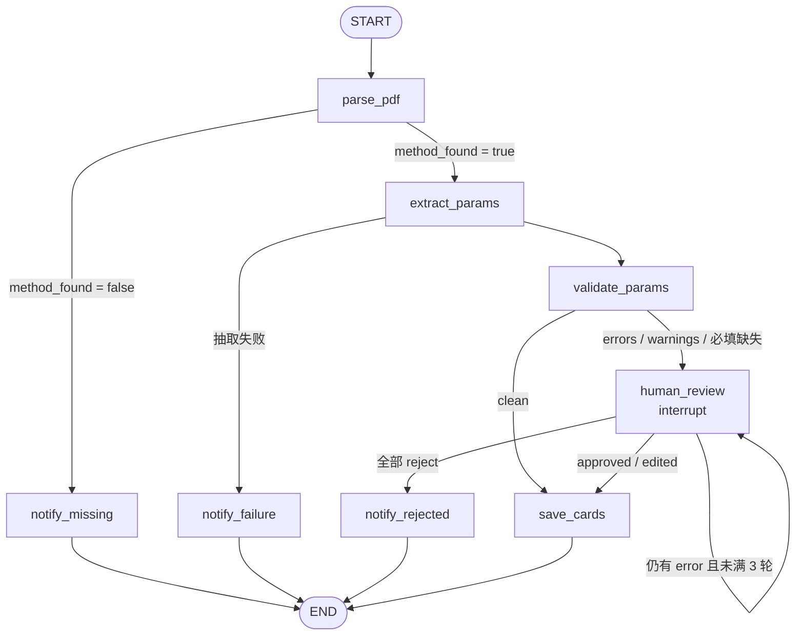
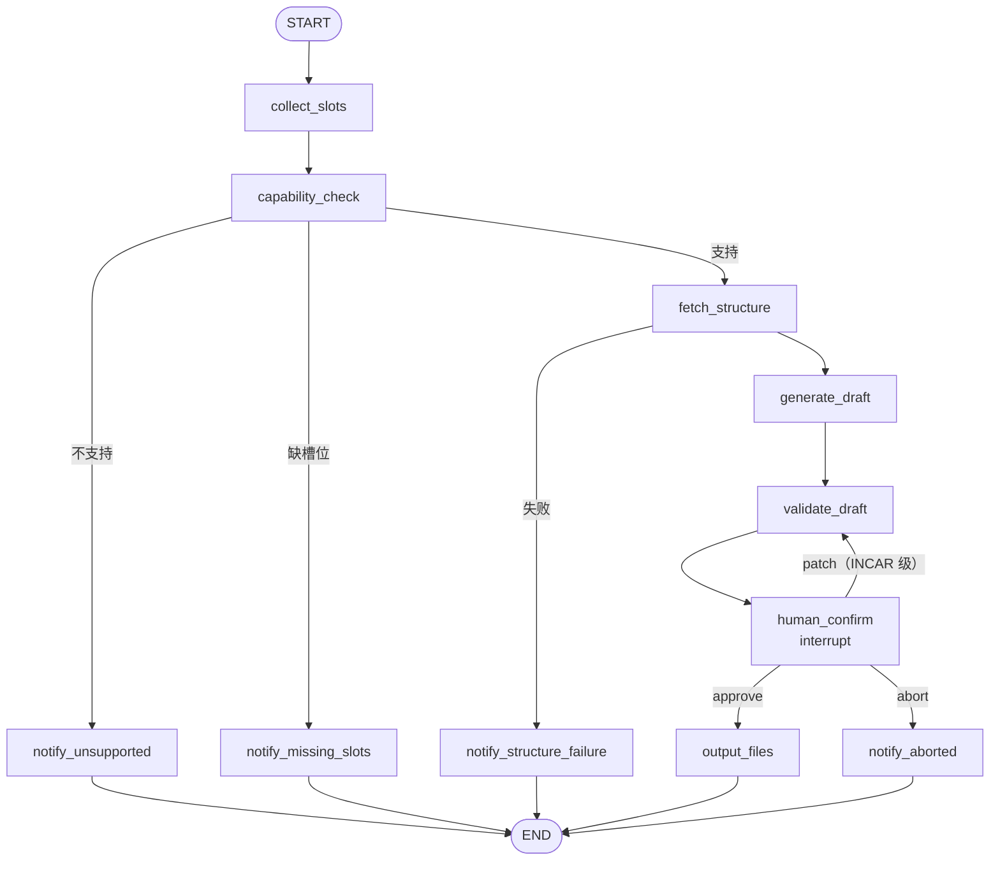
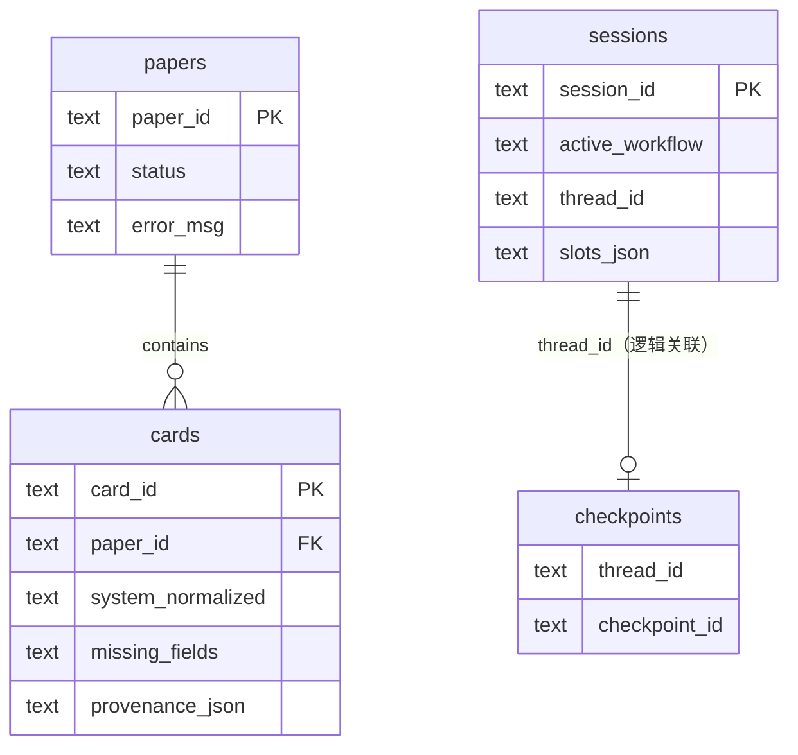
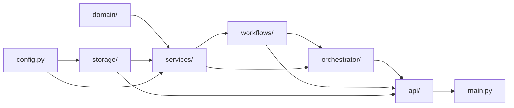

# chem-agent 技术方案设计文档

| 项目 | 内容 |
|---|---|
| 文档版本 | 1.0 |
| 日期 | 2026-11-04 |
| 状态 | 设计定稿（待实现） |
| 对应任务书 | `docs/task.md` |
| 技术栈基线 | `requirements.txt` + 本文 §2.5 增补 |
| 目标读者 | 后端、算法、计算化学领域开发 |

> 本文是实现前的设计契约。文中出现的 Python 类型、表结构、JSON 示例均为设计稿，不代表已经存在对应实现。

---

## 1. 项目概述与核心价值

### 1.1 项目定位

chem-agent 是一个面向计算化学的**领域智能体**，不是通用聊天机器人。它同时服务两类用户：

1. **文献读者**：上传 DFT 论文 PDF，系统定位方法段与相关表格，结构化抽取泛函、U 值、ENCUT、k 点、表面模型等参数，生成可检索、可审核的参数卡片。
2. **计算设置者**：用自然语言或结构化参数描述计算任务，系统收集槽位、校验能力边界、获取/构建结构、生成可审阅的 VASP 输入文件草案（INCAR / POSCAR / KPOINTS），经人工确认后落盘。

### 1.2 核心差异化：计算参数语义层

两条工作流共享同一套资产：

- **Pydantic Schema**：`DFTParameters`、`SurfaceModel`、`CalculationCard` 等，统一文献抽取与计算生成的参数语义。
- **领域规则库**：R1–R7 纯规则引擎，不依赖 LLM，文献校验与计算草案校验共用。
- **参数卡片库**：文献侧产出的卡片可以直接作为计算侧的 `card_id` 输入，形成“读论文 → 用参数 → 生成输入”的闭环。

这是“非通用 Agent”的根基：LLM 只负责抽取和模糊分类，参数语义、规则、能力边界都由领域代码控制。

### 1.3 第一版范围

**支持：**

- 文献 PDF：文本型 PDF；方法段 + 相关表格/表注；抽取一组或多组计算参数；人工审核后保存卡片。
- 计算类型：`relax`、`static`。
- 泛函：`PBE`、`PBE+U`。
- 结构来源：Materials Project（按 `mp_id` 或化学式）、用户上传 CIF/POSCAR。
- 表面：由体相结构 + Miller 指数 + 层数 + 真空层生成 slab。
- VASP 输出：INCAR、POSCAR、KPOINTS 文本与 POTCAR 元素顺序；不生成/分发 POTCAR 文件。

**明确不支持（第一版直接拒绝并给出替代建议）：**

- 多结构/缺陷任务：氧空位形成能、缺陷形成能、界面、异质结、吸附能后处理、过渡态、AIMD、声子、DOS/能带、GW、HSE06、SCAN/r2SCAN 等。
- 扫描版/图片型 PDF（无文本层）；不做 OCR。
- 任意泛函的 VASP 生成；文献侧可以抽取非 PBE/PBE+U 泛函，但计算侧拒绝生成。
- DFT 实际计算提交、HPC 作业管理、POTCAR 生成与分发。
- 用户体系、权限、多租户；第一版默认本机/内网使用。

### 1.4 关键设计原则

- **成本控制**：只把方法段 + 相关表格/表注送 LLM，不送整篇 PDF；路由优先规则，LLM 只做兜底；嵌入模型本地运行。
- **HitL 克制**：文献侧只在存在 error/warning（含必填字段缺失）时暂停审核；计算侧只在输出文件前暂停确认。不搞“每个节点都 interrupt”。
- **能力边界清晰**：`capability_check` 在获取结构之前拒绝不支持的任务，避免无意义的结构查询和 LLM 调用。
- **共享语义层**：Schema 与规则库只有一份，文献侧与计算侧不得各自复制参数定义。
- **可降级**：LLM、MP、Chroma、SQLite、checkpointer 各自故障时的行为在 §9.1 明确定义；不允许“静默降级”。
- **可追溯**：文献卡片保存页码、bbox、原文引用、置信度、审核记录；规则与 Schema 带版本号。

---

## 2. 架构总览

### 2.1 六层架构图

```mermaid
flowchart TB
    subgraph ACCESS["接入层：FastAPI 路由 / 统一响应 / 异常处理"]
        A_CHAT["POST /chat"]
        A_UPLOAD["POST /documents/upload"]
        A_DOC["GET /documents/{paper_id}"]
        A_RETRY["POST /documents/{paper_id}/retry"]
        A_DRAFT["POST /calc/draft"]
        A_FILES["GET /files/{path}"]
        A_HEALTH["GET /health"]
    end

    subgraph ORCH["编排层"]
        O_SPLIT["intent_split.py"]
        O_ROUTE["router.py（rule_router）"]
        O_FALLBACK["llm_fallback.py"]
        O_CACHE["cache.py（cache_check）"]
        O_SLOT["slot_manager.py"]
    end

    subgraph WF["工作流层：LangGraph + AsyncSqliteSaver"]
        W_LIT["文献图"]
        W_CALC["计算图"]
        W_CP["SQLite checkpointer"]
    end

    subgraph CAP["能力层：无状态 Service"]
        C_PDF["PDFParser"]
        C_LLM["LLMExtractor"]
        C_RULE["RuleValidator"]
        C_VASP["VASPGenerator"]
        C_MP["MPClient"]
        C_SLAB["SurfaceBuilder"]
        C_VEC["VectorSearcher"]
        C_QRY["QueryCards"]
    end

    subgraph DOMAIN["领域层"]
        D_SCHEMA["schemas.py"]
        D_RULES["rules.py R1-R7"]
        D_NORM["normalizer.py"]
    end

    subgraph STORE["存储层"]
        S_SQL["SQLite: papers / cards / sessions / checkpoints"]
        S_CHROMA["Chroma: param_cards"]
        S_FILES["data/ 文件系统"]
    end

    A_CHAT --> O_SPLIT
    A_UPLOAD --> W_LIT
    A_DOC --> S_SQL
    A_RETRY --> W_LIT
    A_DRAFT --> W_CALC
    A_FILES --> S_FILES
    A_HEALTH --> S_SQL

    O_SPLIT --> O_ROUTE
    O_ROUTE --> O_FALLBACK
    O_ROUTE --> O_CACHE
    O_ROUTE --> W_LIT
    O_ROUTE --> W_CALC
    O_SLOT --> S_SQL

    W_LIT --> C_PDF
    W_LIT --> C_LLM
    W_LIT --> C_RULE
    W_LIT --> C_QRY
    W_CALC --> C_MP
    W_CALC --> C_SLAB
    W_CALC --> C_VASP
    W_CALC --> C_RULE
    W_CALC --> C_QRY

    W_LIT --> W_CP
    W_CALC --> W_CP
    W_LIT --> S_SQL
    W_CALC --> S_SQL
    W_LIT --> S_FILES
    W_CALC --> S_FILES

    C_LLM --> C_RULE
    C_QRY --> S_SQL
    C_VEC --> S_CHROMA
    C_PDF --> S_FILES
    C_VASP --> S_FILES

    D_SCHEMA -.-> C_PDF
    D_SCHEMA -.-> C_LLM
    D_SCHEMA -.-> C_RULE
    D_SCHEMA -.-> C_VASP
    D_RULES -.-> C_RULE
    D_NORM -.-> C_QRY
```



### 2.2 分层职责与依赖规则

| 层 | 职责 | 允许依赖 | 禁止 |
|---|---|---|---|
| 接入层 | HTTP 路由、Content-Type 协商、统一响应/异常、request_id、文件下载 | 编排层、工作流层、能力层、存储层 | 直接写 SQL、直接调 LLM/MP |
| 编排层 | 意图拆分、规则路由、LLM 兜底、缓存检查、会话槽位 | 领域层、能力层 QueryCards、工作流层 | 直接解析 PDF、直接生成 VASP |
| 工作流层 | 两张 LangGraph 图、条件边、HitL 暂停/恢复、状态持久化 | 能力层、领域层、存储层 | 绕过 Service 直接读文件/发请求 |
| 能力层 | 无状态 Service：解析、抽取、校验、生成、结构获取、向量检索、卡片查询 | 领域层、存储层、外部 API | 持有全局可变状态、直接改 sessions |
| 领域层 | Schema、规则、化学式归一化 | Python 标准库、pydantic、pymatgen（仅 normalizer） | 网络、数据库、LLM、FastAPI |
| 存储层 | SQLite、Chroma、文件系统 | 领域层模型 | 业务规则、路由判断 |

**依赖方向**：上层依赖下层；领域层不依赖任何其他层；能力层不依赖工作流层；工作流层不依赖 FastAPI。

### 2.3 模块目录

```text
chem-agent/
├─ app/
│  ├─ main.py                      # FastAPI 实例、lifespan、异常处理、CORS、request_id
│  ├─ config.py                    # pydantic-settings、路径与密钥
│  ├─ api/
│  │  ├─ chat.py                   # POST /chat（含 review/confirm 恢复）
│  │  ├─ documents.py              # upload / status / retry
│  │  ├─ calc.py                   # POST /calc/draft（JSON + multipart）
│  │  └─ files.py                  # GET /files/{path}、GET /health
│  ├─ orchestrator/
│  │  ├─ intent_split.py           # 四连接词拆分，最多两段
│  │  ├─ router.py                 # rule_router
│  │  ├─ llm_fallback.py           # 轻量 LLM 分类
│  │  ├─ cache.py                  # paper_id 精确缓存检查
│  │  └─ slot_manager.py           # sessions 槽位读写
│  ├─ workflows/
│  │  ├─ literature/
│  │  │  ├─ state.py
│  │  │  ├─ nodes.py
│  │  │  └─ graph.py
│  │  └─ calc/
│  │     ├─ state.py
│  │     ├─ nodes.py
│  │     └─ graph.py
│  ├─ services/
│  │  ├─ pdf_parser.py
│  │  ├─ llm_extractor.py
│  │  ├─ rule_validator.py
│  │  ├─ vasp_generator.py
│  │  ├─ mp_client.py
│  │  ├─ surface_builder.py        # 新增：bulk → slab
│  │  ├─ vector_searcher.py
│  │  └─ query_cards.py
│  ├─ domain/
│  │  ├─ schemas.py
│  │  ├─ rules.py                  # R1-R7
│  │  └─ normalizer.py
│  └─ storage/
│     ├─ db.py                     # SQLAlchemy async engine/models
│     ├─ chroma.py                 # PersistentClient + embedding function
│     └─ files.py                  # 安全路径、读写、清理
├─ scripts/
│  ├─ init_db.py
│  ├─ seed_papers.py
│  └─ reindex_cards.py             # 从 SQLite 重建 Chroma（新增）
├─ tests/
│  ├─ test_rules.py
│  ├─ test_services.py
│  └─ eval_set.json                # 由 eval_set.json.py 改名
├─ docs/
│  └─ technical-design.md
├─ data/
│  ├─ papers/
│  ├─ structures/
│  ├─ outputs/
│  ├─ chroma/
│  └─ chem-agent.db
├─ requirements.txt
├─ README.md
└─ .env                            # 不提交
```

### 2.4 端到端请求流

**文献路径：**

1. `POST /documents/upload`：校验 PDF → 计算 SHA-256 得到 `paper_id` → 落盘 → 写 `papers(status=queued)` → 202。
2. 后台任务：`parsing → extracting → validating`，运行文献图；命中审核则 `needs_review`，否则 `saved`。
3. `GET /documents/{paper_id}`：查询状态；`needs_review` 时返回 `pending_action=review` 与 `thread_id=lit:{paper_id}`。
4. `POST /chat` 且 `action=review`：按 `thread_id` 恢复图；审核通过后写卡片、建向量索引，状态 `saved`。
5. 后续文献检索：`POST /chat` 带 `paper_id` 时先走 `cache_check`（SQL 精确查卡片），命中直接返回。

**计算路径：**

1. `POST /chat`（自然语言）或 `POST /calc/draft`（JSON / multipart 结构化入口）→ 同一张计算图，`thread_id=calc:{session_id}`。
2. `collect_slots` 合并“当前请求 > card_id 卡片 > session 槽位”；`capability_check` 拒绝不支持任务或缺槽位。
3. `fetch_structure`：MP 获取 bulk 或读取用户 CIF；需要表面时由 `SurfaceBuilder` 生成 slab。
4. `generate_draft` → `validate_draft` → `human_confirm`（interrupt，返回 INCAR/POSCAR/KPOINTS 草案）。
5. `POST /chat` 且 `action=confirm`：approve → `output_files` 落盘；patch → 只改 INCAR 级字段并重新校验；abort → 结束。

**编排层约定：**

- `intent_split`：只识别 `另外`、`还有`、`同时`、`顺便` 四个连接词；最多拆两段；空段丢弃；**先拆分、再逐段路由**。
- `rule_router`：文献关键词 `论文/文献/PDF/提取/方法段/paper/literature/extract`；计算关键词 `生成/计算/INCAR/POSCAR/KPOINTS/弛豫/静态/slab/VASP/relax/static`。只命中一侧 → 该意图；两侧都命中或都不命中 → `llm_fallback`。请求带 `paper_id` 时文献优先；带 `card_id` 或显式 `slots` 时计算优先。
- `llm_fallback`：DeepSeek 短 prompt + JSON 输出 `{"intent": "literature|calc|clarify", "reason": "..."}`；`max_tokens` 约 64，超时 10 s；失败或输出非法 → `clarify`。
- `cache_check`：只对“文献 + 有 paper_id”生效；`QueryCards.find_by_paper(paper_id)` 命中直接返回 `cards(source=cache)`，不跑图、不查 Chroma。向量语义检索是另一条路径，不能冒充精确缓存。
- `slot_manager`：读写 `sessions.slots_json`；计算槽位合并优先级为“当前请求 > card_id 卡片 > session”；TTL 7 天；不缓存 LLM 原始输出。

### 2.5 技术栈与版本基线

`requirements.txt` 现有依赖与任务书一致，已在本机验证：Python 3.11.9，`pip check` 无冲突。

**必须增补：**

| 依赖 | 版本 | 用途 | 说明 |
|---|---|---|---|
| `python-multipart` | 0.0.20 | FastAPI `UploadFile`/`Form` | 当前缺失；不加会导致 multipart 路由启动失败 |
| `langgraph-checkpoint-sqlite` | 3.1.3 | HitL 持久化 | 已验证其要求 `langgraph-checkpoint>=4.3.1,<5.0.0`，当前安装 4.3.1，兼容 |
| `sqlite-vec` | 0.1.9 | 上者的传递依赖 | 由 pip 自动安装；显式锁定便于复现 |
| `pytest` | 8.3.4 | 单元/集成测试 | 开发依赖 |
| `pytest-asyncio` | 0.25.3 | 异步测试 | 开发依赖 |

**嵌入模型调整（D9）：**

- 使用 `sentence-transformers/paraphrase-multilingual-MiniLM-L12-v2`，384 维，约 118M 参数，模型文件约 470 MB；CPU 可运行、无 API 成本，但首次使用需下载，冷启动与单次编码延迟高于 `bge-small-zh`。
- 选择理由：种子论文以英文为主、查询可能为中文，需要跨语言检索；该模型覆盖 50+ 语言。
- `BAAI/bge-small-zh-v1.5` 约 24M 参数、512 维、约 95 MB，中文更强但英文/跨语言不是其主目标。第一版不采用；风险见 §9.2。
- 注意：当前环境对 `huggingface.co` 的直连未验证（探测无返回）；首次运行前需确认可访问，或设置 `HF_ENDPOINT` 镜像/预置模型缓存，否则语义检索会降级为 `VECTOR_STORE_UNAVAILABLE`。

**运行环境：**

- Python 3.11.x（当前 3.11.9）；pymatgen 2025.4.16 与 ChromaDB 0.5.23 已在该版本验证可用。
- 单进程 Uvicorn（`--workers 1`）：SQLite 写入、BackgroundTasks、Chroma 持久客户端均按单进程设计；多 worker 需要外部队列/共享存储，第一版不做。

---

## 3. 领域层详细设计

### 3.1 设计原则

- 所有跨层传递的参数必须经过 Pydantic 模型校验；Service 内部可以使用 pymatgen 对象，但**不跨 API/工作流状态边界传递不可序列化对象**。
- 工作流状态中只存 `model_dump(mode="json")` 后的字典；节点内部再重建模型。checkpoint 因此只依赖 JSON 可序列化数据。
- 模型统一 `model_config = ConfigDict(extra="forbid")`；LLM 输出先做宽容解析（忽略多余字段），再进入严格模型。
- 字段缺失用 `None` 表示，不用空字符串/0 代替；`missing_fields` 由规则引擎统一计算。
- 单位写入字段名：`*_ev`、`*_angstrom`，避免“裸数字”。

### 3.2 枚举与基础模型

```python
# 设计稿：Pydantic v2
from __future__ import annotations
from datetime import datetime
from enum import Enum
from typing import Literal
from uuid import UUID
from pydantic import BaseModel, ConfigDict, Field, field_validator, model_validator


class CalculationType(str, Enum):
    RELAX = "relax"
    STATIC = "static"


class FunctionalFamily(str, Enum):
    PBE = "PBE"
    PBE_U = "PBE+U"
    OTHER = "other"


class KPointsScheme(str, Enum):
    GAMMA = "gamma"
    MONKHORST_PACK = "monkhorst-pack"
    EXPLICIT = "explicit"


class Orbital(str, Enum):
    S = "s"
    P = "p"
    D = "d"
    F = "f"


class Severity(str, Enum):
    ERROR = "error"
    WARNING = "warning"
    INFO = "info"


class SourceKind(str, Enum):
    TEXT = "text"
    TABLE = "table"
    CAPTION = "caption"


class PaperStatus(str, Enum):
    QUEUED = "queued"
    PARSING = "parsing"
    EXTRACTING = "extracting"
    VALIDATING = "validating"
    NEEDS_REVIEW = "needs_review"
    SAVED = "saved"
    METHOD_NOT_FOUND = "method_not_found"
    FAILED = "failed"
    REJECTED = "rejected"


class ReviewDecision(str, Enum):
    APPROVE = "approve"
    EDIT = "edit"
    REJECT = "reject"


class ConfirmDecision(str, Enum):
    APPROVE = "approve"
    PATCH = "patch"
    ABORT = "abort"
```

### 3.3 证据与参数模型

#### 3.3.1 Evidence

```python
class Evidence(BaseModel):
    model_config = ConfigDict(extra="forbid")

    source: SourceKind
    page: int | None = Field(default=None, ge=1)
    bbox: tuple[float, float, float, float] | None = None
    quote: str = Field(..., min_length=1, max_length=500)
    field: str | None = None          # 例如 "parameters.hubbard_u[0].u_ev"
    confidence: float | None = Field(default=None, ge=0.0, le=1.0)
```

- `bbox` 使用 PyMuPDF 页面坐标（左上角原点，单位 point），格式 `(x0, y0, x1, y1)`。
- `page` 为 1-based 页码。
- 证据是文献侧可信度的基础；计算侧没有证据时该字段为 `None`，不伪造。

#### 3.3.2 HubbardU

```python
class HubbardU(BaseModel):
    model_config = ConfigDict(extra="forbid")

    element: str = Field(..., pattern=r"^[A-Z][a-z]?$")
    orbital: Orbital
    u_ev: float = Field(..., ge=0.0, le=20.0)   # 有效 U（U_eff）
    j_ev: float = Field(default=0.0, ge=0.0, le=10.0)
    evidence: Evidence | None = None

    @model_validator(mode="after")
    def _effective_u_ge_j(self):
        if self.u_ev < self.j_ev:
            raise ValueError("u_ev 必须大于等于 j_ev")
        return self
```

- 统一使用 `U_eff = U - J`；若文献报告 `U` 和 `J`，抽取时换算为 `u_ev = U - J`，同时保留原始值到 `evidence.quote`。
- 第一版只支持“元素 + 轨道”粒度；同一元素不同轨道可有多条记录。

#### 3.3.3 KPoints

```python
class KPoints(BaseModel):
    model_config = ConfigDict(extra="forbid")

    scheme: KPointsScheme
    mesh: tuple[int, int, int] | None = None
    spacing: float | None = Field(default=None, gt=0.0)   # 倒空间密度，Å^-1
    gamma_centered: bool | None = None
    explicit: list[tuple[float, float, float]] | None = None
    raw: str | None = None                                 # 论文原始写法

    @model_validator(mode="after")
    def _scheme_consistency(self):
        if self.scheme in (KPointsScheme.GAMMA, KPointsScheme.MONKHORST_PACK):
            if self.mesh is None:
                raise ValueError("gamma / monkhorst-pack 方案必须提供 mesh")
            if any(n < 1 for n in self.mesh):
                raise ValueError("mesh 的每个分量必须 >= 1")
        if self.scheme is KPointsScheme.EXPLICIT and not self.explicit:
            raise ValueError("explicit 方案必须提供 explicit 列表")
        return self
```

- `gamma` 和 `monkhorst-pack` 的差异通过 `scheme` 表达；`gamma_centered` 只作为冗余校验/展示字段。
- 表面计算在 `VASPGenerator` 中强制 Gamma-centered（见 §4.7）。
- 文献中“3×3×1”“3x3x1”“Γ-centered 3 3 1”统一归一化为 `mesh=(3,3,1)`，原字符串保留在 `raw`。

#### 3.3.4 DFTParameters

```python
class DFTParameters(BaseModel):
    model_config = ConfigDict(extra="forbid")

    calculation_type: CalculationType
    functional: str = Field(..., min_length=1, max_length=80)   # 归一化展示名，如 "PBE"、"PBE+U"、"HSE06"
    functional_family: FunctionalFamily
    hubbard_u: list[HubbardU] = Field(default_factory=list)
    encut_ev: float | None = Field(default=None, ge=50.0, le=1000.0)
    kpoints: KPoints | None = None
    ediff: float | None = Field(default=None, gt=0.0, le=1e-2)
    ediffg: float | None = Field(default=None, le=0.0)   # 负值表示力收敛
    spin_polarized: bool | None = None
    vdw: str | None = Field(default=None, max_length=40)       # "D3(BJ)"、"D3(zero)"、"D2"
    pseudopotential: str | None = Field(default=None, max_length=80)
    extra_incar: dict[str, str] = Field(default_factory=dict)   # 论文报告但未建模的标签
    notes: str | None = Field(default=None, max_length=2000)
    evidence: list[Evidence] = Field(default_factory=list)
```

- `functional` 保留归一化字符串；`functional_family` 由 `normalizer` 计算并写入，用于规则与能力判断。
- `extra_incar` 只用于展示/追溯，不参与第一版生成逻辑；避免任意标签注入 VASP 输入。
- 文献侧允许 `functional_family=other`（R6 info）；计算侧 `capability_check` 拒绝。

#### 3.3.5 SurfaceModel

```python
class SurfaceModel(BaseModel):
    model_config = ConfigDict(extra="forbid")

    miller: tuple[int, int, int]
    layers: int = Field(..., ge=1, le=30)                  # 沿表面法向的目标 hkl 平面/层数
    vacuum_angstrom: float = Field(..., ge=0.0, le=100.0)  # slab 上下合计的真空区厚度
    termination: str | None = Field(default=None, max_length=120)
    fixed_layers: int | None = Field(default=None, ge=0, le=30)
    dipole_correction: bool = False
    supercell: tuple[int, int, int] = (1, 1, 1)
    slab_thickness_angstrom: float | None = Field(default=None, ge=0.0)
    evidence: list[Evidence] = Field(default_factory=list)

    @field_validator("miller")
    @classmethod
    def _miller_not_zero(cls, v):
        if all(i == 0 for i in v):
            raise ValueError("Miller 指数不能全为 0")
        return v

    @field_validator("supercell")
    @classmethod
    def _supercell_positive(cls, v):
        if any(i < 1 for i in v):
            raise ValueError("supercell 的每个分量必须 >= 1")
        return v
```

**层数与真空层的定义（必须统一）：**

- `layers`：沿表面法向的目标 hkl 平面数。实现时用 `d_hkl` 换算为最小 slab 厚度，再校验生成结果的实际层数；若无法精确命中，取最接近值并在 `SlabResult.warnings` 中说明。
- `vacuum_angstrom`：slab 上下真空区的**合计**厚度，对应 pymatgen `min_vacuum_size` 的语义；规则 R3 的 15 Å 即指该值。
- `fixed_layers`：从 slab 底部固定的层数；`None` 表示不做选择性动力学。
- `termination`：文献中的终止面描述（如 “Co-terminated”）；为空时若存在多个候选终止面，由 `SurfaceBuilder` 选第一个并警告。

#### 3.3.6 ValidationContext / RuleFinding / ValidationReport

```python
class StructureInfo(BaseModel):
    model_config = ConfigDict(extra="forbid")

    formula: str
    elements: list[str]
    num_sites: int = Field(..., ge=1)
    is_slab: bool = False
    max_enmax_ev: float | None = Field(default=None, gt=0.0)  # 预留：由 POTCAR 推导


class ValidationContext(BaseModel):
    model_config = ConfigDict(extra="forbid")

    parameters: DFTParameters
    surface: SurfaceModel | None = None
    structure: StructureInfo | None = None
    calculation_type: CalculationType


class RuleFinding(BaseModel):
    model_config = ConfigDict(extra="forbid")

    rule_id: str = Field(..., pattern=r"^R[1-9][0-9]*$")
    severity: Severity
    field: str | None = None
    message: str
    suggestion: str | None = None
    context: dict[str, str] = Field(default_factory=dict)


class ValidationReport(BaseModel):
    model_config = ConfigDict(extra="forbid")

    findings: list[RuleFinding] = Field(default_factory=list)
    missing_fields: list[str] = Field(default_factory=list)
    rules_version: str = "1.0"

    @property
    def errors(self) -> list[RuleFinding]:
        return [f for f in self.findings if f.severity is Severity.ERROR]

    @property
    def warnings(self) -> list[RuleFinding]:
        return [f for f in self.findings if f.severity is Severity.WARNING]

    @property
    def infos(self) -> list[RuleFinding]:
        return [f for f in self.findings if f.severity is Severity.INFO]

    @property
    def has_blocking_issues(self) -> bool:
        """文献侧是否触发人工审核；info 永不触发。"""
        return bool(self.errors or self.warnings or self.missing_fields)
```

- **两套维度**：`severity ∈ {error, warning, info}` 是严重级别；`missing_fields` 是“必填字段缺失”的派生列表。二者不混用。
- `info` 只提示，不触发审核、不阻断保存。
- `missing_fields` 由 R5 生成；必填字段缺失同时产生 warning（见 §3.5）。

#### 3.3.7 ReviewRecord / CalculationCard

```python
class ReviewRecord(BaseModel):
    model_config = ConfigDict(extra="forbid")

    reviewer: str | None = None
    decision: ReviewDecision
    edited_fields: list[str] = Field(default_factory=list)
    comment: str | None = Field(default=None, max_length=2000)
    reviewed_at: datetime
    round: int = Field(..., ge=1)


class CalculationCard(BaseModel):
    model_config = ConfigDict(extra="forbid")

    card_id: UUID
    paper_id: str
    system_formula: str
    system_normalized: str
    parameters: DFTParameters
    surface: SurfaceModel | None = None
    missing_fields: list[str] = Field(default_factory=list)
    validation: ValidationReport
    provenance: list[Evidence] = Field(default_factory=list)
    review: ReviewRecord | None = None
    review_status: Literal["auto_saved", "reviewed"] = "auto_saved"
    schema_version: str = "1.0"
    rules_version: str = "1.0"
    created_at: datetime
    updated_at: datetime
```

**卡片粒度（D5）：**

- **一次计算一张卡**，同一篇论文可以有多张卡，通过 `paper_id` 聚合。
- 每张卡只描述一个 `calculation_type + functional + system + surface` 组合；避免把 bulk relax、slab relax、PBE、PBE+U 混在一张卡里。
- `provenance_json` 保存整卡的证据列表；`parameters.evidence` 保留字段级证据；两者可以有重叠，写入时去重。

#### 3.3.8 抽取中间模型

```python
class ExtractedCalculation(BaseModel):
    """LLM 输出的一条计算；尚未分配 card_id。"""
    model_config = ConfigDict(extra="forbid")

    system_formula: str
    parameters: DFTParameters
    surface: SurfaceModel | None = None
    evidence: list[Evidence] = Field(default_factory=list)
    confidence: float | None = Field(default=None, ge=0.0, le=1.0)
```

#### 3.3.9 计算槽位与结构/草案模型

```python
class CalcSlots(BaseModel):
    model_config = ConfigDict(extra="forbid")

    calculation_type: CalculationType | None = None
    functional: str | None = None
    functional_family: FunctionalFamily | None = None
    hubbard_u: list[HubbardU] = Field(default_factory=list)
    encut_ev: float | None = Field(default=None, ge=50.0, le=1000.0)
    kpoints: KPoints | None = None
    ediff: float | None = Field(default=None, gt=0.0, le=1e-2)
    ediffg: float | None = Field(default=None, le=0.0)   # 负值表示力收敛
    spin_polarized: bool | None = None
    vdw: str | None = None
    formula: str | None = None
    mp_id: str | None = None
    cif_path: str | None = None
    structure_source: Literal["mp_id", "formula", "cif_upload"] | None = None
    surface: SurfaceModel | None = None
    card_id: str | None = None
    notes: str | None = None
    missing_slots: list[str] = Field(default_factory=list)  # 派生，不来自用户


class StructureRecord(BaseModel):
    model_config = ConfigDict(arbitrary_types_allowed=True)

    structure: object            # pymatgen Structure；仅在 Service 内部传递
    source: Literal["mp_id", "formula", "cif_upload"]
    mp_id: str | None = None
    formula: str
    formula_normalized: str
    num_sites: int
    energy_above_hull: float | None = None
    warnings: list[str] = Field(default_factory=list)


class SlabResult(BaseModel):
    model_config = ConfigDict(arbitrary_types_allowed=True)

    structure: object            # pymatgen Structure
    miller: tuple[int, int, int]
    layers: int
    vacuum_angstrom: float
    slab_thickness_angstrom: float
    termination: str | None = None
    available_terminations: list[str] = Field(default_factory=list)
    fixed_indices: list[int] = Field(default_factory=list)
    warnings: list[str] = Field(default_factory=list)


class VASPDraft(BaseModel):
    model_config = ConfigDict(extra="forbid")

    incar: str
    poscar: str
    kpoints: str
    potcar_order: list[str]
    overrides_applied: dict[str, str] = Field(default_factory=dict)
    warnings: list[str] = Field(default_factory=list)
    generator_version: str = "1.0"
```

- `StructureRecord.structure` / `SlabResult.structure` 只在能力层内部传递；进入工作流状态前必须转成 `structure.as_dict()`（JSON 可序列化），节点内用 `Structure.from_dict()` 重建。
- `CalcSlots.missing_slots` 由 `capability_check` 计算，避免节点/API 各自判断。

#### 3.3.10 校验与序列化约定

- `model_dump(mode="json")` 是跨层唯一边界格式；禁止直接把 Pydantic 对象塞进 LangGraph state。
- `extra="forbid"` 用于内部模型；LLM 原始 JSON 先用 `model_validate(..., strict=False)` 并丢弃未知键，再进入严格模型。
- 时间统一 UTC ISO 8601；数据库存 UTC，API 返回带 `Z` 的字符串。
- 空列表与 `None` 语义不同：`hubbard_u=[]` 表示“明确没有 U”，`None` 在可选字段中表示“未知”；`DFTParameters.hubbard_u` 用空列表，规则 R1 判断空列表。

### 3.4 化学式归一化

`normalizer.py` 只做确定性文本/组成归一化，不调 LLM：

1. Unicode 下标转数字：`₀₁₂₃₄₅₆₇₈₉` → `0-9`。
2. 去空格、去中点/水合物分隔符的歧义处理：`Co3O4·1.5H2O` 先保留水合物整体，再尝试 pymatgen `Composition`。
3. 去掉表面标记：`Co3O4(111)` → 主体 `Co3O4`，表面信息进入 `SurfaceModel`。
4. 用 `pymatgen.core.Composition` 解析，输出 `reduced_formula` 作为 `system_normalized`；例如 `Co₃O₄`、`Co3 O4`、`Co3O4` 都归一化为 `Co3O4`。
5. 解析失败时：保留去空格原文作为 `system_normalized`，写入 `warnings`，不抛异常（文献侧不能因为一个化学式让整篇失败）。
6. `functional` 归一化：大小写、空格、连字符统一；`PBE+U`、`PBE + U`、`PBE+U (GGA)` 归为 `PBE+U`；`GGA-PBE` 归为 `PBE`；HSE06/SCAN 等归为 `other`，保留原始展示名。
7. 归一化函数必须幂等：`normalize(normalize(x)) == normalize(x)`。

### 3.5 规则引擎 R1–R7

#### 3.5.1 规则契约

每条规则是一个纯函数：

```python
RuleFn = Callable[[ValidationContext], list[RuleFinding]]
RULES: list[tuple[str, RuleFn]] = [("R1", r1), ..., ("R7", r7)]
RULES_VERSION = "1.0"
```

- 输入只有 `ValidationContext`；不读数据库、不调 LLM、不发网络请求。
- 输出 `RuleFinding` 列表；顺序固定为 R1→R7，同一规则内按字段名排序。
- 规则 ID 唯一且稳定；新增规则只能追加 R8+，不得改号。
- 同一 `(rule_id, field, message)` 去重；不同规则对同一字段的提示允许并存。
- `RuleValidator.validate(ctx)` 汇总所有规则，生成 `ValidationReport`。

#### 3.5.2 R1–R7 具体逻辑

| ID | 级别 | 适用 | 触发条件 | 输出字段 | 消息模板 | 建议 |
|---|---|---|---|---|---|---|
| R1 | error | 所有 | `functional_family == PBE+U` 且 `hubbard_u` 为空 | `parameters.hubbard_u` | 泛函为 PBE+U，但未提供任何 U 值 | 补充元素/轨道/U_eff，或改用 PBE |
| R2 | warning | 所有 | `hubbard_u` 非空且 `functional_family != PBE+U` | `parameters.functional` | 已提供 U 值，但泛函不是 PBE+U | 将泛函改为 PBE+U，或确认生成时忽略 U 值 |
| R3 | warning | 含表面 | `surface != None` 且 `surface.vacuum_angstrom < 15.0` | `surface.vacuum_angstrom` | 表面真空层 {value} Å 小于 15 Å | 增大真空层至 ≥15 Å，避免周期像相互作用 |
| R4 | warning | 含 Co 3d U | 任一 `HubbardU(element="Co", orbital="d")` 的 `u_ev` 不在 `[2.0, 5.0]` | `parameters.hubbard_u[i].u_ev` | Co 3d 的 U_eff = {value} eV 超出常用区间 [2.0, 5.0] eV | 核对文献；常见 Co3O4 取 3.0–4.0 eV |
| R5 | warning | 所有 | 必填字段缺失（见下） | 缺失字段名 | 缺少必填参数：{field} | 补充参数，或在审核中标注“论文未报告” |
| R6 | info | 所有 | `functional_family == other` | `parameters.functional` | 泛函 {name} 不在第一版 PBE/PBE+U 生成能力内 | 卡片可保存；计算生成请改用 PBE/PBE+U |
| R7 | warning | 含 ENCUT | `encut_ev != None` 且 `encut_ev < 400.0` | `parameters.encut_ev` | ENCUT = {value} eV 低于 400 eV，可能欠收敛 | 核对 ENMAX；过渡金属氧化物常用 450–520 eV |

**R5 的必填字段集合（按计算类型动态）：**

| 条件 | 必填字段 |
|---|---|
| 始终 | `parameters.calculation_type`、`parameters.functional`、`parameters.encut_ev`、`parameters.kpoints` |
| 含表面 | `surface.miller`、`surface.layers`、`surface.vacuum_angstrom` |
| `PBE+U` | `parameters.hubbard_u`（由 R1 以 error 处理，R5 不重复生成） |

- 每个缺失字段生成一条 R5 warning；`missing_fields` 与之一一对应。
- 计算侧生成的草案通常已由预设补齐 ENCUT/k 点，因此 R5 不会误报；文献侧缺 ENCUT/k 点会触发审核，这是“文献参数卡片完整性”的预期行为。
- `system_formula` 由 `ExtractedCalculation` / `CalcSlots` 在进入校验前保证非空，不属于 `DFTParameters`，因此 R5 不重复检查它。

#### 3.5.3 输出格式

```json
{
  "findings": [
    {
      "rule_id": "R1",
      "severity": "error",
      "field": "parameters.hubbard_u",
      "message": "泛函为 PBE+U，但未提供任何 U 值",
      "suggestion": "补充元素/轨道/U_eff，或改用 PBE",
      "context": {"functional": "PBE+U"}
    },
    {
      "rule_id": "R3",
      "severity": "warning",
      "field": "surface.vacuum_angstrom",
      "message": "表面真空层 12.0 Å 小于 15 Å",
      "suggestion": "增大真空层至 ≥15 Å，避免周期像相互作用",
      "context": {"miller": "(111)"}
    }
  ],
  "missing_fields": [],
  "rules_version": "1.0"
}
```

- `field` 使用点路径 + 可选数组下标，便于前端定位；例如 `parameters.hubbard_u[0].u_ev`。
- `context` 只放字符串，避免前端处理嵌套结构。
- 规则引擎不返回“修复后的值”；修复由用户在审核/确认阶段提交。

---

## 4. 能力层 Service 接口定义

### 4.1 通用约定

- 所有 Service 都是**无状态**的：依赖通过构造函数注入（settings、DB session factory、HTTP client、model），不在模块级持有可变全局状态。
- 网络/文件 IO 的 Service 可以是 `async`；CPU 密集或同步库（PyMuPDF、pymatgen、MPRester）用 `asyncio.to_thread` 包装，避免阻塞事件循环。
- Service 抛领域异常 `ServiceError(code, message, details)`；由 API 层映射为 §7 的统一错误码。Service 不返回 HTTP 状态码。
- Service 不直接写 `sessions`；会话由 `slot_manager` 负责。Service 可以写 `cards`/`papers` 的只有明确标注的 `QueryCards` 写方法（实际写卡片由工作流节点调用 QueryCards/Storage）。
- 所有输入/输出类型在 §3 定义；本节只列方法与职责。

### 4.2 PDFParser

**职责**：从文本型 PDF 中定位方法段、相关表格/表注，返回带页码/bbox 的文本块。

```python
class PDFParser:
    def parse(self, pdf_path: Path) -> ParsedPaper: ...
```

**输入**：PDF 文件路径。
**输出**：

```python
class TextBlock(BaseModel):
    text: str
    page: int          # 1-based
    bbox: tuple[float, float, float, float]
    kind: Literal["method", "table", "caption", "body"]
    table_index: int | None = None


class ParsedPaper(BaseModel):
    paper_id: str
    page_count: int
    is_scanned: bool
    method_found: bool
    method_text: str
    blocks: list[TextBlock]
    tables: list[TextBlock]
    captions: list[TextBlock]
    warnings: list[str]
```

**实现要点：**

- 方法段识别：标题正则（不区分大小写）`methods?|computational (details|methods)|calculation details|dft calculations|computational setup|计算方法|计算细节|计算设置`；命中后取到下一个同级标题之前；跨页段落合并。
- 无明确标题时，回退到“前 60% 页面中包含 VASP/DFT/PBE/cutoff/k-point/Hubbard 的连续段落”，并加 warning。
- 表格：使用 PyMuPDF `page.find_tables()` 提取表格文本；表注取表格附近文本块。只要表格位于方法段页面范围，或表注包含 DFT 关键词，就纳入 `tables`/`captions`。
- 扫描版判断：若超过 80% 页面可提取字符数 < 50，则 `is_scanned=True`；工作流返回 `SCANNED_PDF_UNSUPPORTED`，不做 OCR。
- 加密 PDF：`doc.needs_pass` 为真时抛 `INVALID_FILE`。
- 坐标统一为 PyMuPDF point、左上角原点；`bbox` 保存 `(x0, y0, x1, y1)`。
- 不做 LLM 调用；不写数据库；不判断参数是否正确。

**错误**：`INVALID_FILE`（损坏/加密/非 PDF）、`SCANNED_PDF_UNSUPPORTED`。

### 4.3 LLMExtractor

**职责**：把方法段 + 表格/表注文本抽取为一条或多条 `ExtractedCalculation`，附带证据。

```python
class LLMExtractor:
    async def extract(
        self,
        paper_id: str,
        method_text: str,
        tables: list[TextBlock],
        captions: list[TextBlock],
    ) -> list[ExtractedCalculation]: ...
```

**输入**：`paper_id`、方法段文本、相关表格/表注文本块。
**输出**：`list[ExtractedCalculation]`，至少一条；没有可抽取内容时抛 `EXTRACTION_FAILED`。

**实现要点：**

- 模型：通过 `langchain-openai` 调 DeepSeek，`model=deepseek-chat`，`base_url=https://api.deepseek.com/v1`，`temperature=0`。
- 结构化输出：使用 JSON mode（`response_format={"type": "json_object"}`）+ Pydantic 校验；**不依赖 tool calling**，以避免 DeepSeek 兼容性差异。
- Prompt 明确：只输出 JSON；不得编造；缺失字段用 `null`；每个字段尽量给 `evidence`；按“一次计算一个对象”返回数组；非 PBE/PBE+U 泛函照常抽取并标记 `functional_family=other`。
- 输入拼装：方法段优先；表格/表注按与方法段的相关性排序；总字符预算约 24,000 字符（可配置），超限时先截断表格、再截断方法段尾部，并记录 `warnings`。
- 校验失败：把 Pydantic 错误摘要回传模型，**最多修复重试 1 次**；仍失败抛 `EXTRACTION_FAILED`。
- 不写数据库、不建卡片、不调用 RuleValidator；规则校验由工作流节点完成。
- 不把整篇 PDF 送入 LLM；只接收 PDFParser 产出的方法段/表格/表注。

**错误**：`LLM_UNAVAILABLE`（超时/鉴权/限流）、`EXTRACTION_FAILED`（无有效 JSON/校验失败）。

### 4.4 RuleValidator

**职责**：纯规则校验，输出 `ValidationReport`。

```python
class RuleValidator:
    def validate(self, ctx: ValidationContext) -> ValidationReport: ...
```

- 输入：`ValidationContext { parameters, surface, structure?, calculation_type }`。
- 输出：`ValidationReport`（findings + missing_fields + rules_version）。
- 纯参数规则（R1、R2、R4、R5、R6、R7）只读 `parameters`；结构感知规则（R3）读 `surface`；`structure` 预留给后续 ENCUT-ENMAX 规则，第一版 R1–R7 不依赖它。
- 不调 LLM、不写数据库、不抛业务异常（除非法输入）。
- 规则顺序与版本见 §3.5。

### 4.5 MPClient

**职责**：封装 `pymatgen.ext.matproj.MPRester`，按 `mp_id` 或化学式获取**体相**结构；缓存 CIF。

```python
class MPClient:
    async def get_bulk(
        self,
        *,
        mp_id: str | None = None,
        formula: str | None = None,
    ) -> StructureRecord: ...
```

**职责边界：**

- 只返回 bulk `Structure`；**不生成 slab**。slab 由 `SurfaceBuilder` 负责。
- 不写 `cards`/`sessions`；只写 `data/structures/mp/{mp_id}.cif` 缓存。

**实现要点：**

- 优先 `mp_id`：`get_structure_by_material_id(mp_id)`；不存在抛 `STRUCTURE_NOT_FOUND`。
- 否则按化学式：`get_structures(formula)` 取候选；用 `get_summary`/`get_entry_by_material_id` 获取 `energy_above_hull`，优先选最低的稳定相；若多个同能量/无 hull 数据，选第一个并加 warning；候选数写入 `warnings`。
- 缓存：`data/structures/mp/{mp_id}.cif`，TTL 30 天；命中直接 `Structure.from_file`。缓存失效后重新请求并覆盖。
- 同步 MPRester 调用放在 `asyncio.to_thread`；超时 30 s；失败重试 2 次（1 s、2 s 退避）。
- `MP_API_KEY` 从 settings 读取；缺失时启动即报配置错误，而不是运行时静默失败。
- 请求失败抛 `MP_UNAVAILABLE`，并提示“可上传 CIF 继续”。

**错误**：`MP_UNAVAILABLE`、`STRUCTURE_NOT_FOUND`、`INVALID_FILE`（缓存损坏）。

### 4.6 SurfaceBuilder

**职责**：由体相结构和 `SurfaceModel` 生成 slab，处理终止面、层数、真空层、超胞、固定层。

```python
class SurfaceBuilder:
    def build(self, bulk: Structure, surface: SurfaceModel) -> SlabResult: ...
```

**实现要点：**

1. 输入应为常规胞/原胞的 bulk；若用户上传的是已带真空的 slab，先提示“已是表面结构”，避免二次切面。
2. 计算 `d_hkl`：用 `Lattice` 与 Miller 指数得到面间距；`min_slab_size_angstrom = max(layers * d_hkl, 1.0)`。
3. 构造 `SlabGenerator(bulk, miller, min_slab_size=min_slab_size_angstrom, min_vacuum_size=vacuum_angstrom, lll_reduce=True, center_slab=True, primitive=False)`。
4. `get_slabs()` 得到候选终止面；若 `termination` 非空，按终止面描述匹配；否则选第一个，并把所有候选写入 `available_terminations` + warning。
5. 校验实际层数：统计沿 c 方向的原子平面数；若与 `layers` 偏差 > 1，重新生成或加 warning（不静默接受）。
6. 真空层精确化：计算 slab 厚度 `t`，令 `c = t + vacuum_angstrom`，将 slab 居中；`center_slab=True` 只保证初始居中，最终以显式校验为准。
7. 应用 `supercell`（`make_supercell`）。
8. `fixed_layers`：按分数坐标 z 排序，选底部 N 层原子，返回 `fixed_indices`；`VASPGenerator` 据此写选择性动力学。
9. 校验：无重叠原子、`c > 0`、真空层 > 0、Miller 非零；失败抛 `SURFACE_GENERATION_FAILED`。

**错误**：`SURFACE_GENERATION_FAILED`。

### 4.7 VASPGenerator

**职责**：基于 pymatgen `MPRelaxSet` / `MPStaticSet` 和领域覆盖，生成 INCAR / POSCAR / KPOINTS 文本与 POTCAR 元素顺序。

```python
class VASPGenerator:
    def generate(
        self,
        structure: Structure,
        slots: CalcSlots,
        surface: SurfaceModel | None,
    ) -> VASPDraft: ...
```

**预设映射：**

| 计算类型 | 基础预设 |
|---|---|
| `relax` | `MPRelaxSet` |
| `static` | `MPStaticSet` |

**覆盖优先级（高 → 低）：**

1. `collect_slots` 合并后的槽位值（已按“当前请求 > card_id 卡片 > session”解析）
2. 预设默认值（`MPRelaxSet` / `MPStaticSet`）
3. 规则默认值（仅用于预设缺失的兜底，如 slab 的 `ISIF=2`）

> `VASPGenerator` 不读取卡片、不读 session；卡片/session 的合并只发生在 `collect_slots`。因此生成层只看到一份 `CalcSlots`，避免同一优先级规则在多处实现。

**领域覆盖表：**

| 参数 | 规则 |
|---|---|
| `ENCUT` | 合并槽位 > 预设；若最终值 < 400 eV，生成 warning（与 R7 一致） |
| `KPOINTS` | 合并槽位显式网格 > 预设；表面计算强制 Gamma-centered；体相可用 Monkhorst-Pack |
| `+U` | `functional_family=PBE+U` 时设置 `LDAU=True`、`LDAUTYPE=2`；`LDAUL`：s=0、p=1、d=2、f=3；`LDAUU = u_ev + j_ev`、`LDAUJ = j_ev`（`j_ev=0` 时 `LDAUU = u_ev`）；未参与 U 的元素 `LDAUL=-1`、`LDAUU=0`、`LDAUJ=0`；不在结构中的元素报错 |
| `ISPIN` | `spin_polarized=True` → `ISPIN=2`；否则按预设 |
| `MAGMOM` | 第一版沿用预设默认；不提供逐原子磁矩覆盖，避免猜测磁序 |
| `vdW` | `D3(BJ)` → `IVDW=12`；`D3(zero)` → `IVDW=11`；`D2`/其他不自动映射，写 warning，由用户确认 `IVDW` |
| 偶极校正 | `surface.dipole_correction=True` → `LDIPOL=True`、`IDIPOL=3` |
| `EDIFF` / `EDIFFG` | 合并槽位 > 预设；relax 默认 `EDIFF=1e-5`、`EDIFFG=-0.02`；static 用预设/槽位 |
| relax | `NSW=100`、`IBRION=2`；slab 用 `ISIF=2`，bulk 用 `ISIF=3`；`EDIFF`/`EDIFFG` 见上 |
| static | `NSW=0`、`IBRION=-1`、`ISIF=2`；`EDIFF` 见上 |
| 选择性动力学 | `fixed_layers != None` → POSCAR 加 `Selective dynamics`，固定底部 N 层 |
| POTCAR | 不生成内容；返回 `potcar_order`（与 POSCAR 元素顺序一致），由用户提供 POTCAR |

**输出：**

- `INCAR`：pymatgen `Incar` 写出；覆盖项合并后统一写。
- `POSCAR`：`Poscar` 写出；必要时加选择性动力学。
- `KPOINTS`：显式写 `Gamma`/`Monkhorst-Pack`/explicit；表面强制 Gamma。
- `potcar_order`：`set.potcar_symbols` 的元素顺序；不读取/不复制 POTCAR 文件。
- `overrides_applied`：记录每个覆盖来自“合并槽位/预设/规则”，便于审计。
- `warnings`：未知 vdW、元素不在结构中、ENCUT 偏低、K 点转换等。

**错误**：`DRAFT_VALIDATION_FAILED`（+U 元素不在结构、POSCAR/KPOINTS 不一致）、`OUTPUT_WRITE_FAILED`（由 output 节点处理）。

### 4.8 VectorSearcher

**职责**：封装 ChromaDB 查询与写入，用于语义检索相似参数卡片。

```python
class VectorSearcher:
    async def upsert(self, card: CalculationCard) -> None: ...
    async def search(self, query: str, top_k: int = 5, where: dict | None = None) -> list[VectorHit]: ...
    async def delete(self, card_id: str) -> None: ...
```

**实现要点：**

- 持久客户端：`chromadb.PersistentClient(path="./data/chroma")`；collection `param_cards`，`metadata={"hnsw:space": "cosine"}`。
- Embedding：`SentenceTransformerEmbeddingFunction(model_name="paraphrase-multilingual-MiniLM-L12-v2", device="cpu", normalize_embeddings=True)`；维度 384。
- 嵌入文本（模板固定，便于重建索引）：

```text
system: {system_normalized}
calculation: {calculation_type}
functional: {functional}
hubbard_u: {element orbital u_ev; ...}
encut: {encut_ev} eV
kpoints: {scheme} {mesh}
surface: ({miller}) {layers} layers, vacuum {vacuum} A
notes: {notes}
```

- metadata 只放标量：`card_id`、`paper_id`、`system_normalized`、`calculation_type`、`functional_family`、`has_surface`、`review_status`、`missing_count`、`created_at`。
- `id = card_id`；`upsert` 幂等。
- 向量检索是**辅助路径**：精确缓存检查用 SQL `paper_id`（§5.2），Chroma 用于“没有 paper_id 时找相似卡片/为计算侧推荐 card_id”。
- Chroma 失败不阻断卡片保存：SQLite 仍是事实源；卡片 `chroma_indexed=0`，由 `scripts/reindex_cards.py` 补偿。

**错误**：`VECTOR_STORE_UNAVAILABLE`（查询/写入失败）。

### 4.9 QueryCards

**职责**：卡片的 SQL 读写、过滤、聚合；是 `cache_check` 与计算侧 `card_id` 的数据入口。

```python
class QueryCards:
    async def save_card(self, card: CalculationCard) -> None: ...
    async def mark_chroma_indexed(self, card_id: str, indexed: bool) -> None: ...
    async def get_by_id(self, card_id: str) -> CalculationCard | None: ...
    async def find_by_paper(self, paper_id: str) -> list[CalculationCard]: ...
    async def filter(
        self,
        *,
        system_normalized: str | None = None,
        functional: str | None = None,
        paper_id: str | None = None,
        card_id: str | None = None,
        limit: int = 20,
        offset: int = 0,
    ) -> list[CalculationCard]: ...
    async def aggregate(self, *, group_by: Literal["system", "functional", "paper"]) -> list[AggregateRow]: ...
```

**聚合语义：**

```python
class AggregateRow(BaseModel):
    key: str
    card_count: int
    paper_count: int
    avg_encut_ev: float | None
    avg_u_ev: float | None
    missing_count: int
```

- `group_by="system"`：按 `system_normalized` 分组；`"functional"`：按 `functional_family`；`"paper"`：按 `paper_id`。
- `avg_u_ev`：对该组所有卡片的 `HubbardU.u_ev` 取平均；无 U 时为 `None`。
- 在 Python 层聚合（先按过滤条件取行，再聚合），避免 SQLite JSON1 依赖；第一版数据量小，可接受。
- `save_card` 负责 cards 表插入/更新（含 `missing_fields`、`provenance_json`、`validation_json`）；`papers.status` 由工作流节点通过 `storage/db.py` 的 paper repository 更新，不由 QueryCards 越权修改。
- 第一版不单独暴露 `/cards` 端点；供 `cache_check`、计算图、测试与后续版本使用。

### 4.10 Service 依赖矩阵

| Service | 依赖 | 被谁调用 |
|---|---|---|
| PDFParser | PyMuPDF、文件系统 | 文献图 `parse_pdf` |
| LLMExtractor | DeepSeek、Pydantic Schema | 文献图 `extract_params` |
| RuleValidator | 领域规则、Schema | 文献图 `validate_params`、计算图 `validate_draft` |
| MPClient | MPRester、文件缓存 | 计算图 `fetch_structure` |
| SurfaceBuilder | pymatgen SlabGenerator | 计算图 `fetch_structure` |
| VASPGenerator | pymatgen sets、Schema | 计算图 `generate_draft` |
| VectorSearcher | Chroma、sentence-transformers | 卡片保存、语义检索 |
| QueryCards | SQLAlchemy、Schema | `cache_check`、计算图、文献图 `save_cards` |

---

## 5. LangGraph 工作流设计

### 5.1 通用约定

- 两张图都用 `StateGraph` 编译；checkpointer 使用 `langgraph.checkpoint.sqlite.aio.AsyncSqliteSaver`，与业务 SQLite 同一文件（WAL 模式）。
- `thread_id`：
  - 文献图：`lit:{paper_id}`
  - 计算图：`calc:{session_id}`
- HitL 使用 `langgraph.types.interrupt(payload)`；恢复使用 `Command(resume=payload)`，并传入相同 `config.configurable.thread_id`。
- 状态中只放 JSON 可序列化数据；Pydantic 模型在节点入口/出口做 `model_dump(mode="json")` / `model_validate`。
- 每个节点失败时写 `status` 与 `error={code, message, details}`，条件边进入对应的 `notify_*` 节点后 `END`；不把异常直接抛到 FastAPI。
- 条件边函数只读 state，不做 IO。
- 图不直接操作 FastAPI `Request`；所有外部输入通过 state 传入。

### 5.2 文献图

#### 5.2.1 State 定义

```python
import operator
from typing import Annotated, TypedDict

class LiteratureState(TypedDict, total=False):
    paper_id: str
    pdf_path: str

    parsed: dict | None              # ParsedPaper.model_dump(mode="json")
    method_found: bool
    extracted: list[dict]            # list[ExtractedCalculation.model_dump(...)]
    reports: list[dict]              # list[ValidationReport.model_dump(...)]
    review_round: int
    review_payload: dict | None      # 最近一次 interrupt 的 resume 值
    approved: list[dict]             # 审核后的 ExtractedCalculation
    rejected: list[dict]
    saved_card_ids: Annotated[list[str], operator.add]

    status: str                      # 与 PaperStatus 对齐
    error: dict | None               # {code, message, details}
    messages: Annotated[list[str], operator.add]
```

- `saved_card_ids` 与 `messages` 使用 `operator.add` reducer；其余字段后写覆盖。
- `reports[i]` 与 `extracted[i]` 按索引对应；审核编辑后重新生成 reports。

#### 5.2.2 节点流转



> `human_review` 的“重新校验”发生在节点内部：resume 后应用编辑、重建模型、调用 RuleValidator；若仍有 error，节点再次 `interrupt`。图中的自环表示这一行为，不再单独建 `revalidate` 节点。

#### 5.2.3 节点职责

| 节点 | 输入 | 输出 | 说明 |
|---|---|---|---|
| `parse_pdf` | `pdf_path` | `parsed`, `method_found` | 调 PDFParser；扫描版 → error 2002；method_found=false → `notify_missing` |
| `extract_params` | `parsed` | `extracted` | 调 LLMExtractor；失败 → error（5001/2004）→ `notify_failure` |
| `validate_params` | `extracted` | `reports` | 为每条计算构造 ValidationContext；调 RuleValidator；决定是否审核 |
| `human_review` | `extracted`, `reports`, `review_round` | `approved`, `rejected`, `review_round` | `interrupt`；应用 approve/edit/reject；编辑后重新校验；最多 3 轮 |
| `save_cards` | `approved` | `saved_card_ids`, `status` | 一次计算一张卡；写 cards；upsert Chroma；更新 papers 状态 |
| `notify_missing` | `paper_id` | `status` | `method_not_found`，返回“未定位到方法段” |
| `notify_failure` | `error` | `status` | `failed`，错误落库 |
| `notify_rejected` | — | `status` | 用户拒绝全部候选，`rejected` |

#### 5.2.4 条件边

- `parse_pdf → notify_missing`：`method_found` 为 false。
- `parse_pdf → extract_params`：`method_found` 为 true。
- `extract_params → notify_failure`：`status == "failed"`。
- `extract_params → validate_params`：抽取成功。
- `validate_params → human_review`：任一 report 满足 `has_blocking_issues`（error/warning/missing_fields）。
- `validate_params → save_cards`：全部无阻塞问题。
- `human_review → save_cards`：至少一条 approved（含 edit）。
- `human_review → notify_rejected`：全部 reject。
- `human_review → human_review`：仍有 error 且 `review_round < 3`（节点内部再次 interrupt）。

#### 5.2.5 HitL 审核协议

**暂停 payload（`human_review` 内调用 `interrupt`）：**

```json
{
  "type": "review_request",
  "paper_id": "9f2c...",
  "thread_id": "lit:9f2c...",
  "round": 1,
  "candidates": [
    {
      "index": 0,
      "system_formula": "Co3O4",
      "system_normalized": "Co3O4",
      "parameters": {"calculation_type": "relax", "functional": "PBE+U", "hubbard_u": [{"element": "Co", "orbital": "d", "u_ev": 3.5}], "encut_ev": 520, "kpoints": {"scheme": "monkhorst-pack", "mesh": [3, 3, 1], "gamma_centered": true}},
      "surface": {"miller": [1, 1, 1], "layers": 6, "vacuum_angstrom": 15.0, "termination": "Co-terminated"},
      "findings": [{"rule_id": "R4", "severity": "warning", "field": "parameters.hubbard_u[0].u_ev", "message": "Co 3d 的 U_eff = 5.5 eV 超出常用区间 [2.0, 5.0] eV", "suggestion": "核对文献；常见 Co3O4 取 3.0–4.0 eV"}],
      "missing_fields": [],
      "evidence": [{"source": "table", "page": 5, "bbox": [100.0, 200.0, 480.0, 260.0], "quote": "U_eff(Co 3d) = 3.5 eV", "field": "parameters.hubbard_u[0].u_ev", "confidence": 0.92}]
    }
  ]
}
```

**恢复 payload（`POST /chat` `action=review`）：**

```json
{
  "decisions": [
    {
      "index": 0,
      "decision": "edit",
      "parameters": {"encut_ev": 520, "hubbard_u": [{"element": "Co", "orbital": "d", "u_ev": 3.5}]},
      "surface": {"vacuum_angstrom": 15.0},
      "comment": "按表 2 修正 U 值"
    }
  ]
}
```

- `decision`：`approve`（原样保存）、`edit`（合并给定字段后保存）、`reject`（丢弃该条）。
- `edit` 只允许合并 `parameters` / `surface` 的字段；不允许改 `paper_id`、`system_formula` 的来源。
- `error` 未清零时不允许 `approve`；只能 `edit` 或 `reject`，否则返回 `GRAPH_RESUME_FAILED` 并再次 `interrupt`。
- 合并后必须重新跑 RuleValidator；error 未清零则再次 `interrupt`。
- 最多 3 轮；第 3 轮仍有 error → `status=failed`，错误码 `REVIEW_REJECTED`/`GRAPH_RESUME_FAILED`（按具体情况）。
- 审核通过后 `save_cards` 写卡片；即使 Chroma 失败也保存 SQLite 卡片并返回 warning。

### 5.3 计算图

#### 5.3.1 State 定义

```python
class CalcState(TypedDict, total=False):
    session_id: str
    thread_id: str
    raw_message: str | None

    user_slots: dict                 # 当前请求显式槽位
    card_id: str | None
    card_snapshot: dict | None       # CalculationCard.model_dump(...)
    slots: dict                      # CalcSlots.model_dump(...)，合并结果

    capability: dict | None          # {supported: bool, reason, suggestions}
    structure_dict: dict | None      # Structure.as_dict()
    structure_meta: dict | None      # StructureRecord 的可序列化部分
    slab_dict: dict | None           # SlabResult.structure.as_dict()
    slab_meta: dict | None           # SlabResult 的可序列化部分

    draft: dict | None               # VASPDraft.model_dump(...)
    validation: dict | None          # ValidationReport.model_dump(...)
    confirm_round: int
    confirm_payload: dict | None
    patch_history: list[dict]        # [{round, patch}]
    output_files: Annotated[list[dict], operator.add]

    status: str
    error: dict | None
    messages: Annotated[list[str], operator.add]
```

- pymatgen `Structure` 通过 `as_dict()` 存入 state；节点内 `Structure.from_dict()` 重建。
- `slots` 是合并后的 `CalcSlots`；`user_slots` 保留原始请求，便于审计。
- `output_files` 使用 append reducer；其余覆盖。

#### 5.3.2 节点流转



#### 5.3.3 节点职责

| 节点 | 输入 | 输出 | 说明 |
|---|---|---|---|
| `collect_slots` | `user_slots`, `card_id`, `session_id` | `slots` | 优先级：当前请求 > 卡片 > session；归一化化学式；加载卡片快照；不提问、不 IO 外部服务 |
| `capability_check` | `slots`, `raw_message` | `capability` | 先拒绝不支持任务；再检查必填槽位；不通过 → notify 节点 |
| `fetch_structure` | `slots` | `structure_dict`, `slab_dict` | CIF 读取/POST 上传结构；MP 获取 bulk；需要表面则 SurfaceBuilder；失败 → notify |
| `generate_draft` | `structure_dict`, `slots` | `draft` | VASPGenerator；+U 元素不在结构等错误 → 失败 |
| `validate_draft` | `draft`, `slots` | `validation` | RuleValidator + 草案一致性检查（POTCAR 顺序、POSCAR/KPOINTS 非空） |
| `human_confirm` | `draft`, `validation`, `confirm_round` | `confirm_payload` | `interrupt` 返回草案；approve/patch/abort；patch 只改 INCAR 级字段并重校验 |
| `output_files` | `draft`, `slots`, `session_id` | `output_files`, `status` | 写 `data/outputs/calc_{session_id}/`；更新 sessions；返回文件清单 |
| `notify_unsupported` | `capability` | `status` | 明确告知不支持原因与替代方案 |
| `notify_missing_slots` | `slots.missing_slots` | `status` | 返回缺槽位澄清，session 保留已收集槽位 |
| `notify_structure_failure` | `error` | `status` | MP 不可用时提示上传 CIF；结构不存在时提示检查 mp_id/化学式 |
| `notify_aborted` | — | `status` | 用户放弃；不写输出文件 |

#### 5.3.4 能力检查规则

**直接拒绝（`CAPABILITY_UNSUPPORTED`）的触发：**

- `calculation_type` 不是 `relax` / `static`。
- `functional_family` 不是 `PBE` / `PBE+U`。
- `raw_message` 或 `notes` 命中多结构/后处理关键词：`氧空位`、`oxygen vacancy`、`缺陷形成能`、`formation energy`、`界面`、`interface`、`异质结`、`heterostructure`、`过渡态`、`transition state`、`AIMD`、`分子动力学`、`声子`、`phonon`、`能带`、`band structure`、`DOS`、`态密度`、`光学性质`、`GW`、`HSE06`、`SCAN`、`r2SCAN`。
- 计算类型为 `static` 且用户明确要求“从非弛豫结构直接静态”时，不拒绝，但在草案 warning 中提示“建议先 relax”；第一版不做自动判断。

**替代建议：**

- 氧空位/缺陷：建议第一版先做完整 slab 的 relax/static，缺陷结构由用户上传 CIF。
- 界面/异质结：建议拆成两个单相 slab 分别计算，或上传已构建的超胞。
- 能带/DOS/声子/AIMD：建议使用专门工作流，本系统只生成基态输入。

**必填槽位检查（`SLOT_MISSING`）：**

- 始终：`calculation_type`、`functional_family`、结构来源（`mp_id` / `formula` / `cif_path` 至少一个）。
- 表面：`surface.miller`、`surface.layers`、`surface.vacuum_angstrom`。
- `PBE+U`：`hubbard_u` 非空（同时会被 R1 以 error 拦截）。
- `ENCUT`、`kpoints` 不要求用户显式给出：缺省用预设；生成后在 R7/草案 warning 中提示。

#### 5.3.5 HitL 确认协议

**暂停 payload（`human_confirm` 内调用 `interrupt`）：**

```json
{
  "type": "confirm_request",
  "session_id": "6b1d...",
  "thread_id": "calc:6b1d...",
  "round": 1,
  "draft": {
    "incar": "SYSTEM = Co3O4\nENCUT = 520\n...",
    "poscar": "Co3O4\n1.0\n...\n",
    "kpoints": "Automatic generation\n0\nGamma\n3 3 1\n0 0 0\n",
    "potcar_order": ["Co", "O"]
  },
  "validation": {"findings": [], "missing_fields": [], "rules_version": "1.0"},
  "applied_overrides": {"ENCUT": "slot", "KPOINTS": "slot", "LDAU": "slot"}
}
```

**恢复 payload（`POST /chat` `action=confirm`）：**

```json
{
  "decision": "patch",
  "patch": {
    "encut_ev": 520,
    "kpoints": {"scheme": "gamma", "mesh": [3, 3, 1], "gamma_centered": true},
    "hubbard_u": [{"element": "Co", "orbital": "d", "u_ev": 3.5}],
    "ediff": "1e-5"
  },
  "comment": "提高 k 点并固定 U 值"
}
```

**patch 白名单（D8）：**

- 允许：`encut_ev`、`kpoints`、`hubbard_u`、`ediff`、`ediffg`。
- 禁止：`miller`、`layers`、`vacuum_angstrom`、`termination`、`fixed_layers`、`supercell`、`mp_id`、`formula`、`cif_path`、`calculation_type`、`functional`。
- 禁止字段出现在 patch 中 → `GRAPH_RESUME_FAILED`（4002）或 `CONFIRM_REQUIRED`（3007），提示“结构级修改请重新提交 /calc/draft”。
- patch 应用后：重新生成 INCAR/KPOINTS（POSCAR 不变）→ 重新跑 `validate_draft`。
  - 若出现 error：`confirm_round < 3` → 再次 `interrupt`；否则失败。
  - 若只有 warning：进入 `output_files`（用户已经通过 patch 表达确认；warning 仍在最终报告/响应中返回）。
- approve：仅当 `validation.errors` 为空时允许直接 `output_files`；存在 error 时返回 `DRAFT_VALIDATION_FAILED`/`CONFIRM_REQUIRED`，要求 patch 或 abort。
- abort：`notify_aborted`，不写文件。

#### 5.3.6 输出文件节点

- 目录：`data/outputs/calc_{session_id}/`。**不要直接用 `thread_id` 作目录名**：LangGraph 的 `thread_id=calc:{session_id}` 含 `:`，而 Windows 文件名不允许冒号；`thread_id` 只用于 checkpoint，文件路径用 sanitize 后的 `session_id`。
- 文件：`INCAR`、`POSCAR`、`KPOINTS`、`manifest.json`。
- `manifest.json` 内容：`session_id`、`thread_id`、`system_formula`、`parameters`、`surface`、`validation`、`overrides_applied`、`generator_version`、`created_at`。
- 若目录已存在（重复确认），覆盖同名文件并在 manifest 记录 `regenerated_at`；不删除其他文件。
- 返回 `output_files: [{name, path, url, size}]`，`url` 为 `GET /files/{relative_path}`。
- 写文件失败 → `OUTPUT_WRITE_FAILED`，不更新 sessions 为 completed。

### 5.4 暂停/恢复与并发

- checkpointer 在 FastAPI `lifespan` 中用 `AsyncSqliteSaver` 初始化：打开 aiosqlite 连接后执行 `await checkpointer.setup()` 建表，再挂到编译后的图上；同一 SQLite 文件，WAL 模式。关闭时释放连接。
- `/chat` `action=message` 且同 `session_id` 已有暂停图：先返回 `WORKFLOW_STATE_CONFLICT`，提示先 review/confirm 或 abort；不允许并发恢复。
- 恢复时用 `Command(resume=payload)`；如果 thread 不存在/已完成 → `GRAPH_RESUME_FAILED`。
- `sessions.active_workflow` 与 `thread_id` 在进入工作流时写入；完成后清空。
- 文献上传的后台任务不阻塞 HTTP；其 thread 为 `lit:{paper_id}`，审核通过 `paper_id` 恢复，不依赖 chat session。
- 同一 `paper_id` 的上传任务/重试互斥：`papers.status` 处于 `parsing/extracting/validating/needs_review/saved` 时，重试返回 409；只有 `failed`/`method_not_found` 可重试。

---

## 6. 存储层设计

### 6.1 SQLite 总体

- 文件：`data/chem-agent.db`；URL：`sqlite+aiosqlite:///./data/chem-agent.db`。
- 启动时 `PRAGMA journal_mode=WAL`、`PRAGMA foreign_keys=ON`、`PRAGMA busy_timeout=5000`。
- SQLAlchemy 2.0 async ORM；`scripts/init_db.py` 调用 `Base.metadata.create_all`。
- 不使用 Alembic（第一版）；`schema_version` 写入 cards，后续迁移脚本按版本处理。
- 单进程写；多 worker 不支持（见 §2.5）。

### 6.2 表结构

#### 6.2.1 papers

| 列 | 类型 | 约束 | 说明 |
|---|---|---|---|
| `paper_id` | TEXT | PK | PDF 字节的 SHA-256（hex），稳定 cache key |
| `filename` | TEXT | NOT NULL | 原始文件名 |
| `file_path` | TEXT | NOT NULL | `data/papers/{paper_id}.pdf` |
| `file_hash` | TEXT | NOT NULL UNIQUE | 与 `paper_id` 相同，显式保留 |
| `file_size` | INTEGER | NOT NULL | 字节 |
| `page_count` | INTEGER | NULL | 解析后写入 |
| `status` | TEXT | NOT NULL | `PaperStatus` 值 |
| `method_found` | BOOLEAN | NULL | 解析后写入 |
| `error_msg` | TEXT | NULL | 最近失败原因（人可读） |
| `error_code` | INTEGER | NULL | 业务错误码 |
| `thread_id` | TEXT | NOT NULL | `lit:{paper_id}` |
| `meta_json` | TEXT | NOT NULL DEFAULT '{}' | 标题/DOI/别名等扩展信息 |
| `created_at` | DATETIME | NOT NULL | UTC |
| `updated_at` | DATETIME | NOT NULL | UTC |

索引：`(status)`、`(created_at)`。

#### 6.2.2 cards

| 列 | 类型 | 约束 | 说明 |
|---|---|---|---|
| `card_id` | TEXT | PK | UUID4 |
| `paper_id` | TEXT | FK → papers.paper_id, ON DELETE CASCADE | 一篇论文多张卡 |
| `system_formula` | TEXT | NOT NULL | 原始化学式 |
| `system_normalized` | TEXT | NOT NULL | 归一化化学式（查询/聚合） |
| `calculation_type` | TEXT | NOT NULL | relax/static |
| `functional` | TEXT | NOT NULL | 展示名 |
| `functional_family` | TEXT | NOT NULL | PBE/PBE+U/other |
| `parameters_json` | TEXT | NOT NULL | `DFTParameters.model_dump_json()` |
| `surface_json` | TEXT | NULL | `SurfaceModel.model_dump_json()` |
| `missing_fields` | TEXT | NOT NULL DEFAULT '[]' | JSON 数组（任务书要求字段） |
| `validation_json` | TEXT | NOT NULL | `ValidationReport.model_dump_json()` |
| `provenance_json` | TEXT | NOT NULL DEFAULT '[]' | 页码/bbox/原文/置信度/审核记录（任务书要求） |
| `review_json` | TEXT | NULL | `ReviewRecord.model_dump_json()` |
| `review_status` | TEXT | NOT NULL | auto_saved/reviewed |
| `chroma_id` | TEXT | NOT NULL | 等于 card_id |
| `chroma_indexed` | INTEGER | NOT NULL DEFAULT 0 | 0/1；补偿索引用 |
| `schema_version` | TEXT | NOT NULL | 1.0 |
| `rules_version` | TEXT | NOT NULL | 1.0 |
| `created_at` | DATETIME | NOT NULL | UTC |
| `updated_at` | DATETIME | NOT NULL | UTC |

索引：`(paper_id)`、`(system_normalized)`、`(functional_family)`、`(calculation_type)`、`(system_normalized, functional_family)`。

**为什么 `missing_fields` 单独存：** 任务书明确要求；用于卡片完整性统计、聚合与前端展示，避免每次解析 `validation_json`。写入时与 `validation.missing_fields` 保持一致。

**为什么 `provenance_json` 单独存：** 任务书 I16 确认；整卡证据与字段级证据可能来自不同表格/页码，单独保存便于审核与追溯。写入时与 `parameters.evidence` 去重合并。

#### 6.2.3 sessions

| 列 | 类型 | 约束 | 说明 |
|---|---|---|---|
| `session_id` | TEXT | PK | UUID4 |
| `active_workflow` | TEXT | NULL | literature/calc/null |
| `thread_id` | TEXT | NULL | 当前暂停图的 thread |
| `slots_json` | TEXT | NOT NULL DEFAULT '{}' | `CalcSlots` 的 JSON；文献侧可为空 |
| `last_action` | TEXT | NULL | message/review/confirm/abort |
| `created_at` | DATETIME | NOT NULL | UTC |
| `updated_at` | DATETIME | NOT NULL | UTC |
| `expires_at` | DATETIME | NOT NULL | 默认 7 天 |

索引：`(expires_at)`；启动时/定时清理过期 session（不删除仍被 checkpoint 引用的行，直到 TTL 到期）。

#### 6.2.4 checkpoints（由 `langgraph-checkpoint-sqlite` 自动创建）

- 表结构由包管理，应用不直接读写、不纳入 ORM、不做迁移。
- 与业务表同库；避免跨库事务/锁竞争。
- 该包还会创建 `sqlite-vec` 相关表/虚拟表；不要手工修改。
- 备份时连同 `data/chem-agent.db` 一起备份。

#### 6.2.5 ER 图



> `checkpoints` 是逻辑关联，不是数据库外键；表由第三方包创建。

### 6.3 ChromaDB collection

| 项 | 设计 |
|---|---|
| 客户端 | `chromadb.PersistentClient(path="./data/chroma")` |
| collection | `param_cards` |
| 距离 | cosine（`hnsw:space=cosine`） |
| Embedding | `SentenceTransformerEmbeddingFunction(model_name="paraphrase-multilingual-MiniLM-L12-v2", device="cpu", normalize_embeddings=True)` |
| 维度 | 384 |
| ID | `card_id` |
| document | §4.8 固定模板 |
| metadata | `card_id`, `paper_id`, `system_normalized`, `calculation_type`, `functional_family`, `has_surface`, `review_status`, `missing_count`, `created_at` |

- metadata 值只能是 `str/int/float/bool`；复杂结构不进 metadata。
- 写入时机：`save_cards` 成功后；`upsert` 幂等。
- 更新时机：卡片重新审核/修改后 `upsert`；删除卡片时 `delete`。
- 一致性：SQLite 是事实源；Chroma 失败不阻断保存，`cards.chroma_indexed=0`；`scripts/reindex_cards.py` 扫描 `chroma_indexed=0` 的卡片重建。
- 首次启动会下载模型（约 470 MB）；失败时禁用语义检索并返回 `VECTOR_STORE_UNAVAILABLE`，不影响 SQL 路径。

### 6.4 文件系统

| 路径 | 内容 | 清理 |
|---|---|---|
| `data/papers/{paper_id}.pdf` | 原始 PDF | 按 paper 删除时清理（第一版无删除 API） |
| `data/structures/mp/{mp_id}.cif` | MP bulk 缓存 | TTL 30 天 |
| `data/structures/slabs/{cache_key}.cif` | slab 缓存（可选，S3 后启用） | TTL 30 天 |
| `data/structures/uploads/{session_id}/{safe_name}.cif` | 用户上传结构 | session TTL 后清理 |
| `data/outputs/calc_{session_id}/` 下的 `INCAR`、`POSCAR`、`KPOINTS`、`manifest.json` | 生成文件 | 手动/后续清理任务 |
| `data/chroma/` | Chroma 持久目录 | 随卡片删除/重建 |
| `data/chem-agent.db` | SQLite（含 checkpoint） | 备份 |

**路径安全：**

- 所有用户提供的文件名先 sanitize：只保留 `[A-Za-z0-9._-]`，长度 ≤128，禁止以 `.` 开头。
- 写入/读取前 `Path.resolve()`，必须位于允许根目录（papers/structures/outputs）之下；拒绝 `..`、绝对路径、符号链接逃逸。
- `/files/{path}` 只允许 `data/outputs/` 下的文件；越界返回 `PATH_FORBIDDEN`。
- 上传限制：PDF ≤ 50 MB，CIF/POSCAR ≤ 10 MB（可配置）；流式读取，避免一次性读入内存。

---

## 7. 接入层 API 契约

### 7.1 通用约定

- 所有 JSON 响应使用统一 envelope：

```json
{
  "code": 0,
  "message": "ok",
  "data": {},
  "request_id": "3f1c2b7e-..."
}
```

- `code=0` 表示成功；非 0 见 §7.9 错误码表。
- 实现为 Pydantic 泛型 `ApiResponse[T]`；`data` 使用以 `type` 为判别键的联合模型（`clarify` / `cards` / `review_request` / `confirm_request` / `output_files` / `results` / `document_status` / `ack` / `health`）。FastAPI 异常处理器统一把 `ServiceError`、`RequestValidationError` 与未捕获异常转换为同一 envelope。
- `request_id`：优先使用请求头 `X-Request-ID`，否则生成 UUID；响应头回写，日志携带。
- 成功但需要下一步操作（review/confirm）仍返回 HTTP 200/202 与 `code=0`，`data.type` 指明类型。
- 错误响应也使用 envelope，HTTP 状态按 §7.9 映射；`data` 为 `null` 或 `{type:"error", details:{...}}`。
- 所有时间 ISO 8601 UTC；所有 ID 为字符串。
- 第一版无鉴权；默认绑定 `127.0.0.1`。CORS 通过 `CORS_ORIGINS` 配置，默认 `*` 仅开发环境。

### 7.2 `POST /chat`

自然语言入口，也承载 HitL 恢复。

**请求：**

```json
{
  "session_id": "6b1d...",
  "message": "帮我提取这篇论文的 DFT 参数",
  "paper_id": "9f2c...",
  "card_id": null,
  "action": "message",
  "payload": null
}
```

| 字段 | 类型 | 必填 | 说明 |
|---|---|---|---|
| `session_id` | string/null | 否 | 为空则新建 session；响应返回 |
| `message` | string | `action=message` 时必填 | 自然语言 |
| `paper_id` | string/null | 否 | 文献侧已上传 PDF 的 ID |
| `card_id` | string/null | 否 | 计算侧引用已有卡片 |
| `action` | string | 否 | `message`（默认）/`review`/`confirm` |
| `payload` | object/null | review/confirm 时必填 | 审核/确认数据，见 §5.2.5、§5.3.5 |

**成功响应类型（`data.type`）：**

- `clarify`：需要补充信息。
- `cards`：命中 cache 或语义检索的卡片。
- `review_request`：文献审核暂停。
- `confirm_request`：计算草案确认暂停。
- `output_files`：计算完成，文件清单。
- `results`：两个子请求串行处理后的结果数组。
- `document_status`：paper 尚未完成，返回状态。
- `ack`：审核/确认已处理但无更多内容。

**示例 1：自然语言计算请求 → 确认暂停：**

```json
{
  "session_id": "6b1d...",
  "message": "用 PBE+U 对 Co3O4 (111) 做 6 层 slab 的弛豫，真空 15 Å，U=3.5 eV",
  "action": "message"
}
```

```json
{
  "code": 0,
  "message": "ok",
  "request_id": "0b6e...",
  "data": {
    "type": "confirm_request",
    "session_id": "6b1d...",
    "thread_id": "calc:6b1d...",
    "round": 1,
    "draft": {
      "incar": "SYSTEM = Co3O4\nENCUT = 520\nLDAU = .TRUE.\n...",
      "poscar": "Co3O4\n1.0\n...",
      "kpoints": "Automatic generation\n0\nGamma\n3 3 1\n0 0 0\n",
      "potcar_order": ["Co", "O"]
    },
    "validation": {"findings": [], "missing_fields": [], "rules_version": "1.0"}
  }
}
```

**示例 2：文献审核恢复：**

```json
{
  "session_id": "a1b2...",
  "paper_id": "9f2c...",
  "action": "review",
  "payload": {
    "decisions": [
      {"index": 0, "decision": "approve"}
    ]
  }
}
```

```json
{
  "code": 0,
  "message": "ok",
  "request_id": "9c1d...",
  "data": {
    "type": "cards",
    "source": "extracted",
    "cards": [
      {
        "card_id": "d3f1...",
        "paper_id": "9f2c...",
        "system_normalized": "Co3O4",
        "calculation_type": "relax",
        "functional": "PBE+U",
        "missing_fields": [],
        "review_status": "reviewed"
      }
    ]
  }
}
```

**示例 3：两个子请求：**

请求 `"提取这篇论文的参数，另外帮我生成 Co3O4 的 INCAR"`。

```json
{
  "code": 0,
  "message": "ok",
  "request_id": "7d2a...",
  "data": {
    "type": "results",
    "results": [
      {"type": "review_request", "paper_id": "9f2c...", "round": 1},
      {"type": "confirm_request", "session_id": "6b1d...", "round": 1}
    ]
  }
}
```

- 两段串行；任一段失败不阻断另一段，各自在 `results` 中返回成功/错误对象。
- `session_id` 始终返回（新建或沿用）。

**行为说明：**

- `action=message`：`intent_split` → 每段 `rule_router`/`llm_fallback` → 文献/计算。
- 文献段：若带 `paper_id`，先 `cache_check`（SQL 精确查卡片）；命中返回 `cards(source=cache)`，不跑图。若 paper 尚未完成，返回 `document_status`。
- 文献段无 `paper_id`：若有可用语义查询，`VectorSearcher` 返回相似卡片；否则 `clarify` 要求上传 PDF/提供 paper_id。
- 计算段：进入计算图；`card_id` 从 QueryCards 读取并作为槽位来源。
- `action=review`：要求 `paper_id`（文献）或 `session_id`（计算）；恢复 `lit:{paper_id}`。
- `action=confirm`：要求 `session_id`；恢复 `calc:{session_id}`。
- 同一 session 已有暂停图时，新 `message` 返回 `WORKFLOW_STATE_CONFLICT`；必须先 review/confirm/abort。

### 7.3 `POST /documents/upload`

**请求：** `multipart/form-data`

```text
file=@Co3O4_paper.pdf
```

- 只接受 PDF；校验扩展名 + `%PDF-` 魔数 + MIME。
- 计算 SHA-256 作为 `paper_id`。
- 重复上传：返回 200 + 现有 `document_status`，不重复入队；`failed` 状态需调用 retry。

**成功（202）：**

```json
{
  "code": 0,
  "message": "accepted",
  "request_id": "4a7c...",
  "data": {
    "type": "document_status",
    "paper_id": "9f2c...",
    "status": "queued",
    "status_url": "/documents/9f2c..."
  }
}
```

**重复（200）：**

```json
{
  "code": 0,
  "message": "already exists",
  "request_id": "4a7c...",
  "data": {
    "type": "document_status",
    "paper_id": "9f2c...",
    "status": "saved",
    "status_url": "/documents/9f2c..."
  }
}
```

**后台状态机：**

`queued → parsing → extracting → validating → saved | needs_review | method_not_found | failed`

- `needs_review`：图在 `human_review` checkpoint 暂停；`thread_id=lit:{paper_id}`。
- `failed`：`error_msg`/`error_code` 落库；可 retry。
- `method_not_found`：未定位方法段；可 retry 或人工处理。

### 7.4 `GET /documents/{paper_id}`

**成功：**

```json
{
  "code": 0,
  "message": "ok",
  "request_id": "5b8d...",
  "data": {
    "type": "document_status",
    "paper_id": "9f2c...",
    "status": "needs_review",
    "method_found": true,
    "page_count": 12,
    "error_msg": null,
    "error_code": null,
    "card_ids": [],
    "pending_action": "review",
    "thread_id": "lit:9f2c...",
    "created_at": "2026-11-04T00:00:00Z",
    "updated_at": "2026-11-04T00:01:10Z"
  }
}
```

- `pending_action`：`review` / `confirm`（本接口只会有 review）/ null。
- `card_ids`：已保存卡片。
- 不存在 → 404 + `PAPER_NOT_FOUND`。

### 7.5 `POST /documents/{paper_id}/retry`

- 仅允许 `status ∈ {failed, method_not_found}`；否则 409 `DOCUMENT_STATE_CONFLICT`。
- 重置 `status=queued`、清空 `error_msg/error_code`，重新入队后台任务；**不删除**已保存卡片（若存在）。
- 响应 202 `document_status`。
- 同一 paper 正在处理时返回 409。

### 7.6 `POST /calc/draft`

结构化计算入口；与 `/chat` 进入**同一张计算图**（D3）。

**Content-Type 协商：**

- `application/json`：JSON 请求。
- `multipart/form-data`：`payload`（JSON 字符串）+ 可选 `structure_file`（CIF/POSCAR）。
- 其他：415 + `UNSUPPORTED_CONTENT_TYPE`。

**JSON 请求：**

```json
{
  "session_id": "6b1d...",
  "card_id": null,
  "slots": {
    "calculation_type": "relax",
    "functional": "PBE+U",
    "formula": "Co3O4",
    "mp_id": "mp-1234",
    "hubbard_u": [{"element": "Co", "orbital": "d", "u_ev": 3.5}],
    "encut_ev": 520,
    "kpoints": {"scheme": "gamma", "mesh": [3, 3, 1], "gamma_centered": true},
    "surface": {"miller": [1, 1, 1], "layers": 6, "vacuum_angstrom": 15.0, "dipole_correction": true}
  }
}
```

- `session_id` 为空则新建；响应返回。
- `card_id` 与 `slots` 同时存在时：`slots` 覆盖卡片同名字段。
- `structure_file` 与 `mp_id`/`formula` 同时存在时：`structure_file` 优先。

**multipart 请求：**

```text
POST /calc/draft
Content-Type: multipart/form-data

payload={"slots":{"calculation_type":"relax","functional":"PBE","surface":null}}
structure_file=@Co3O4.cif
```

**成功（确认暂停）：**

```json
{
  "code": 0,
  "message": "ok",
  "request_id": "8e3f...",
  "data": {
    "type": "confirm_request",
    "session_id": "6b1d...",
    "thread_id": "calc:6b1d...",
    "round": 1,
    "draft": {
      "incar": "SYSTEM = Co3O4\n...",
      "poscar": "Co3O4\n1.0\n...",
      "kpoints": "Automatic generation\n0\nGamma\n3 3 1\n0 0 0\n",
      "potcar_order": ["Co", "O"]
    },
    "validation": {"findings": [], "missing_fields": [], "rules_version": "1.0"}
  }
}
```

**缺槽位（422）：**

```json
{
  "code": 3001,
  "message": "缺少必填槽位",
  "request_id": "8e3f...",
  "data": {"type": "clarify", "missing_slots": ["functional", "surface.miller"]}
}
```

**不支持（422）：**

```json
{
  "code": 3002,
  "message": "第一版不支持氧空位形成能计算",
  "request_id": "8e3f...",
  "data": {
    "type": "clarify",
    "suggestions": [
      "先对完整 slab 做 relax/static",
      "缺陷结构可通过 CIF 上传后计算"
    ]
  }
}
```

- 成功后通过 `POST /chat` `action=confirm` 确认/修改；本接口不重复实现确认逻辑。
- 若 `session_id` 已有暂停图，返回 409 `WORKFLOW_STATE_CONFLICT`。

### 7.7 `GET /files/{path}`

- `path` 为相对 `data/outputs/` 的路径，例如 `calc_6b1d.../INCAR`（不使用含 `:` 的 `thread_id` 作目录名）。
- 成功返回 `FileResponse`（`application/octet-stream` 或按扩展名）；失败返回 JSON envelope。
- 路径安全：解析后必须在 `data/outputs/` 下；否则 403/404。
- 不提供任意 `data/papers/` 下载，避免泄露原始论文；如后续需要，单独加鉴权。

### 7.8 `GET /health`

```json
{
  "code": 0,
  "message": "ok",
  "request_id": "1a2b...",
  "data": {
    "type": "health",
    "status": "degraded",
    "components": {
      "sqlite": "ok",
      "checkpointer": "ok",
      "llm": "unavailable",
      "mp": "ok",
      "chroma": "ok",
      "embedding_model": "ok"
    }
  }
}
```

- 仅做轻量探测，不调用 DeepSeek/MP 的付费接口；`llm`/`mp` 以最近一次调用结果或配置检查为准。
- SQLite/checkpointer 不可用 → HTTP 503，`status=down`。

### 7.9 错误码总表

| code | 名称 | HTTP | 含义 |
|---|---|---|---|
| 0 | OK | 200/202 | 成功 |
| 1000 | INVALID_REQUEST | 400 | 请求体/参数不合法 |
| 1001 | UNSUPPORTED_CONTENT_TYPE | 415 | `/calc/draft` 非 JSON/multipart |
| 1002 | INVALID_FILE | 400 | 非 PDF/CIF、损坏、加密 |
| 1003 | PAYLOAD_TOO_LARGE | 413 | 超过上传限制 |
| 2001 | PAPER_NOT_FOUND | 404 | paper_id 不存在 |
| 2002 | SCANNED_PDF_UNSUPPORTED | 422 | 扫描版 PDF，第一版不支持 |
| 2003 | METHOD_SECTION_NOT_FOUND | 422 | 未定位方法段 |
| 2004 | EXTRACTION_FAILED | 422 | LLM 输出无法形成有效参数 |
| 2005 | REVIEW_REJECTED | 200 | 用户拒绝全部候选（非错误，data 说明） |
| 2006 | DOCUMENT_STATE_CONFLICT | 409 | 当前状态不允许该操作 |
| 3001 | SLOT_MISSING | 422 | 缺少必填计算槽位 |
| 3002 | CAPABILITY_UNSUPPORTED | 422 | 第一版能力边界外 |
| 3003 | STRUCTURE_NOT_FOUND | 404 | MP 无匹配结构/CIF 无效 |
| 3004 | MP_UNAVAILABLE | 503 | MP 不可用；可改用 CIF |
| 3005 | SURFACE_GENERATION_FAILED | 422 | slab 生成失败 |
| 3006 | DRAFT_VALIDATION_FAILED | 422 | 草案校验不通过 |
| 3007 | CONFIRM_REQUIRED | 409 | 需要先确认/修改 |
| 3008 | OUTPUT_WRITE_FAILED | 500 | 输出文件写入失败 |
| 4001 | SESSION_NOT_FOUND | 404 | session 不存在/过期 |
| 4002 | GRAPH_RESUME_FAILED | 409 | thread 不存在/已完成/恢复失败 |
| 4003 | WORKFLOW_STATE_CONFLICT | 409 | 已有暂停图或并发操作 |
| 4004 | REVIEW_REQUIRED | 409 | 文献侧需要审核 |
| 5001 | LLM_UNAVAILABLE | 503 | DeepSeek 超时/鉴权/限流 |
| 5002 | VECTOR_STORE_UNAVAILABLE | 503 | Chroma/嵌入模型不可用 |
| 5003 | DATABASE_ERROR | 500 | SQLite 错误 |
| 5004 | CHECKPOINTER_UNAVAILABLE | 503 | checkpointer 不可用 |
| 5005 | INTERNAL_ERROR | 500 | 未分类异常 |
| 6001 | FILE_NOT_FOUND | 404 | 文件不存在 |
| 6002 | PATH_FORBIDDEN | 403 | 路径越界 |

**HTTP 状态映射原则：**

- 请求/参数问题 400/415/413；资源不存在 404；状态冲突 409；能力/校验问题 422；依赖不可用 503；内部错误 500。
- 503 响应带 `Retry-After: 5`（可配置）。

---

## 8. 开发顺序与模块依赖关系

### 8.1 模块依赖图



- `domain/` 不依赖任何其他层；先写 Schema/规则/归一化。
- `storage/` 依赖 config 和 domain（模型序列化）。
- `services/` 依赖 domain/storage/config；每个 Service 可单独测试。
- `workflows/` 依赖 services/orchestrator；orchestrator 不依赖 workflows（避免循环）。
- `api/` 依赖 workflows/orchestrator/services/storage；`main.py` 只做装配。

### 8.2 阶段划分

| 阶段 | 范围 | 可验证产出 | 退出条件 |
|---|---|---|---|
| S1 领域层 | `schemas.py`、`rules.py` R1–R7、`normalizer.py` | `pytest tests/test_rules.py`：R1–R7 每条至少 2 个正/反例；Schema roundtrip；归一化幂等 | 规则输出稳定、无外部依赖；`missing_fields` 与 warning 一一对应 |
| S2 存储层 | db models、`init_db.py`、`files.py`、`chroma.py` | 建表成功；papers/cards/sessions CRUD；Chroma upsert/search 返回 384 维；路径穿越测试 | SQLite WAL 生效；Chroma 可用/失败两种路径都有日志 |
| S3 离线 Service | PDFParser、SurfaceBuilder、VASPGenerator、RuleValidator 集成 | 解析样例 PDF；CIF → slab；生成 PBE 与 PBE+U 的 INCAR/POSCAR/KPOINTS；检查 `potcar_order` | 不依赖 LLM/MP 即可跑通；生成结果可被人工按 VASP 规范检查 |
| S4 LLM 抽取 | LLMExtractor、`eval_set.json` | 对评测集逐条抽取；字段级 precision/recall；修复重试路径；扫描版拒绝 | 抽取结果通过 Pydantic；无编造值（evidence 为空时字段为 null）；错误码正确 |
| S5 结构获取 | MPClient、QueryCards、VectorSearcher 接入 | `mp_id`/化学式取结构；缓存命中；MP 断网降级；卡片过滤/聚合；语义检索 | MP 失败返回 3004 且提示 CIF；SQL 缓存不依赖 Chroma |
| S6 文献图 | 文献 state/nodes/graph、checkpointer、upload/status/review | 上传样例 PDF → needs_review → `/chat action=review` → saved；进程重启后恢复；retry | 状态机全部路径可达；审核 3 轮上限；卡片/证据落库 |
| S7 计算图 | 计算 state/nodes/graph、confirm/patch/output | JSON 与 multipart 各一条端到端；能力拒绝；patch 白名单；输出文件/URL | 确认前不写输出；patch 只改 INCAR 级；结构级 patch 被拒绝 |
| S8 编排与 API | intent_split、router、llm_fallback、cache、slot_manager、统一 envelope | 混合意图拆分；规则冲突兜底；cache 命中；错误码/HTTP 映射；`/health` | 两个子请求串行且互不阻断；所有错误走统一 envelope |

### 8.3 测试与验收

- **单元测试**：规则 R1–R7、normalizer、VASPGenerator、SurfaceBuilder、路径安全、错误码映射。
- **图测试**：用 `InMemorySaver` 跑确定性流程（不打真实 LLM/MP）；用 `AsyncSqliteSaver` 测中断恢复。
- **集成测试**：用 mock LLM/MP 的 fixture 跑 upload→review→saved、calc→confirm→output；再用真实 DeepSeek/MP 做少量冒烟。
- **评测集**：`tests/eval_set.json` 每条包含 PDF 片段/方法段、人工标注参数、期望缺失字段；指标：
  - 字段级 precision/recall（ENCUT、k 点、U、真空层、Miller、层数）；
  - 多计算拆分的完整率；
  - `missing_fields` 准确率；
  - 不支持泛函是否被正确标为 `other`。
- **人工验收**：生成的 INCAR/POSCAR/KPOINTS 必须由计算化学人员检查；第一版不承诺“可直接提交生产计算”。

---

## 9. 风险与降级方案

### 9.1 降级矩阵

| 故障 | 受影响接口/路径 | 行为 | 返回 | 恢复 |
|---|---|---|---|---|
| LLM 不可用 | 文献抽取、自然语言槽位解析、`llm_fallback` | 规则路由仍可用；结构化 `/calc/draft`（槽位齐全）仍可生成；文献后台任务失败 | `/chat` 返回 5001；`papers.status=failed`；`/calc/draft` 若无需 LLM 正常 | 恢复后 `POST /documents/{id}/retry`；用户重发消息 |
| MP 不可用 | 按 `formula`/`mp_id` 取结构的计算 | 已有 CIF 上传路径仍可用；不缓存失败结果 | 503 + 3004，附“上传 CIF 继续” | 恢复后重试；CIF 用户不受影响 |
| Chroma 不可用 | 语义检索、卡片向量写入 | SQLite 卡片保存不受影响；`chroma_indexed=0`；cache_check 用 SQL 仍命中 | 保存成功但 warning；语义查询 503 + 5002 | `scripts/reindex_cards.py` 重建 |
| 嵌入模型不可用 | 同上 | 与 Chroma 不可用同路径 | 5002；首次下载失败日志明确 | 预下载模型/挂载缓存目录 |
| SQLite 不可用 | 全部有状态接口 | 无法读写 paper/card/session/checkpoint；服务不可用 | 503 + 5003；`/health` down | 修复磁盘/权限/锁；重启 |
| checkpointer 不可用 | HitL review/confirm | 文献上传仍可解析，但无法暂停审核；计算无法确认 | 503 + 5004；已有暂停图不可恢复 | 修复 DB/包；重启 |
| PDFParser 失败 | 文献上传 | 状态 failed，错误落库；不重试坏文件 | 2002/1002；`GET /documents` 可见 | 用户修复/重传；retry |
| SurfaceBuilder 失败 | 表面计算 | 不生成草案；提示终止面/层数/结构问题 | 422 + 3005 | 用户改参数或上传 slab |
| 输出写入失败 | 计算确认 | 不标记完成；保留草案与 checkpoint | 500 + 3008 | 修复磁盘后重试 confirm |

**降级原则：**

- 不让一个非关键依赖（Chroma/嵌入）阻断事实数据（SQLite 卡片）落库。
- 不让 LLM 故障伪装成“成功”；文献侧必须显式 failed。
- 结构化计算路径尽量不依赖 LLM：槽位齐全时可直接生成。
- 所有降级都返回业务错误码，不用空数组/空卡片冒充结果。

### 9.2 风险清单

| 风险 | 影响 | 概率 | 缓解 |
|---|---|---|---|
| 方法段/表格抽取漏参数 | 卡片不完整，用户误判 | 中高 | 方法段+表格/表注；证据页码/bbox；R5 缺失警告；人工审核；评测集 |
| 扫描版/图片型 PDF | 无法抽取 | 中 | 明确拒绝（2002），提示用户提供文本版；不做 OCR |
| LLM 编造 U/ENCUT/k 点 | 错误参数进入计算 | 中 | JSON schema + 禁止编造提示；evidence 必须；Pydantic 校验；人工审核；规则范围检查 |
| DeepSeek JSON 模式/限流/超时 | 抽取失败 | 中 | 一次修复重试；超时配置；失败落库；可 retry；不自动切换未配置的模型 |
| MP API key/配额/服务波动 | 无法取结构 | 中 | 30s 超时+2 次退避重试；CIF 上传兜底；错误提示明确 |
| pymatgen slab 终止面/层数歧义 | slab 与论文不一致 | 中高 | 显式 `layers`/`vacuum` 语义；候选终止面列表+warning；人工确认；固定层可配 |
| SlabGenerator 枚举多终止面耗时 | 请求变慢/超时 | 中 | 限制 `max_normal_search`；按 `termination` 过滤；以 `(mp_id, miller, layers, vacuum, termination, supercell)` 为键缓存 slab |
| 真空层/层数语义误读 | slab 周期像相互作用 | 中 | Schema 文档明确“上下合计真空”；R3 阈值；生成后校验实际真空 |
| VASP +U/磁矩/ENCUT/POTCAR 细节 | 输入不可用或结果错误 | 中高 | 预设+领域覆盖；POTCAR 顺序返回；人工审核；不承诺生产级 |
| POTCAR 许可 | 不能分发 | 高 | 不生成/不复制 POTCAR；只返回元素顺序；用户自备 |
| 嵌入模型约 470 MB/首次下载/CPU 延迟 | 冷启动慢、离线失败 | 中 | 预下载/挂载缓存；失败禁用语义检索；SQL cache 不受影响 |
| 跨语言检索质量 | 中文查询漏召回 | 中 | 多语模型；评测中英文 query；必要时后续换 bge-m3 |
| SQLite 并发/多 worker | 锁冲突、checkpoint 丢失 | 中 | 单 worker；WAL；busy_timeout；不承诺多进程；后续外部队列 |
| Chroma/SQLite 双写不一致 | 检索不到已保存卡片 | 中 | SQLite 事实源；`chroma_indexed` 标记；reindex 脚本 |
| 成本超预算 | LLM 费用高 | 中 | 只送方法段+表格；字符预算；路由规则优先；记录 token/成本；llm_fallback 仅歧义时调用 |
| PDF prompt injection | 模型输恶意内容 | 低中 | 输入视为数据；输出严格 schema；不执行任何工具；人工审核 |
| 上传/路径穿越/密钥泄露 | 安全事件 | 低中 | 大小/类型限制；路径校验；`.env` 不入库；默认 localhost |
| Schema/规则版本漂移 | 旧卡片误用 | 中 | `schema_version`/`rules_version`；变更时迁移/重校验；文档记录 |
| 范围蔓延（缺陷/界面/能带） | 第一版失控 | 高 | `capability_check` 拒绝；非目标清单；建议替代方案 |
| 中文/英文消息不一致 | 用户体验 | 低 | 错误消息统一中文；领域术语保留英文缩写；API 字段英文 |

### 9.3 运行与安全

- **绑定地址**：默认 `127.0.0.1:8000`；不要在无鉴权情况下暴露公网。
- **上传**：PDF/CIF 大小限制、类型校验、流式读取；不执行上传文件中的任何代码。
- **路径**：所有文件路径 `resolve()` 后校验根目录；`/files` 只读 outputs。
- **密钥**：`DEEPSEEK_API_KEY`、`MP_API_KEY` 只从环境/.env 读取；`.env` 在 `.gitignore`；日志不打印密钥。
- **依赖**：锁定版本；升级前跑 `pip check`、规则/生成快照测试。
- **备份**：`data/chem-agent.db`（含 checkpoint）与 `data/outputs/` 一起备份；Chroma 可重建。
- **日志**：结构化日志，字段含 `request_id`、`paper_id`、`session_id`、`thread_id`、`rule_id`、`error_code`；不记录完整 PDF 文本/密钥。
- **成本**：记录每次 LLM 的输入/输出 token（若 provider 返回）与耗时；按请求/论文聚合；设置日预算告警（第一版可只记录）。

### 9.4 后续演进（非第一版）

- 支持更多泛函（HSE06/SCAN）与更完整的 INCAR 覆盖。
- OCR/扫描版 PDF。
- 多结构/缺陷/界面工作流。
- 用户体系、权限、审计、团队卡片库。
- 外部任务队列（Celery/RQ）替代 BackgroundTasks；多 worker。
- 卡片版本迁移与自动重校验。
- 更细的检索（按体系/泛函/表面过滤 + 重排模型）。
- 可视化审核界面（当前仅 API）。

---

## 附录 A：配置项

| 环境变量 | 默认 | 说明 |
|---|---|---|
| `APP_ENV` | `dev` | dev/prod |
| `DATA_DIR` | `./data` | 数据根目录 |
| `DATABASE_URL` | `sqlite+aiosqlite:///./data/chem-agent.db` | SQLite |
| `CHROMA_DIR` | `./data/chroma` | Chroma 持久目录 |
| `DEEPSEEK_API_KEY` | 无 | 必填（LLM 功能） |
| `DEEPSEEK_BASE_URL` | `https://api.deepseek.com/v1` | OpenAI 兼容 |
| `DEEPSEEK_MODEL` | `deepseek-chat` | 抽取/兜底模型 |
| `MP_API_KEY` | 无 | 必填（MP 功能） |
| `EMBEDDING_MODEL` | `paraphrase-multilingual-MiniLM-L12-v2` | 384 维 |
| `HF_ENDPOINT` | 无 | 可选；HuggingFace 镜像地址/预下载缓存 |
| `LLM_TIMEOUT_SECONDS` | `120` | 抽取超时 |
| `MP_TIMEOUT_SECONDS` | `30` | MP 超时 |
| `MAX_PDF_MB` | `50` | PDF 上传限制 |
| `MAX_STRUCTURE_MB` | `10` | CIF/POSCAR 限制 |
| `SESSION_TTL_HOURS` | `168` | 7 天 |
| `CORS_ORIGINS` | `*` | 开发默认；生产收紧 |
| `LOG_LEVEL` | `INFO` | 日志级别 |

## 附录 B：决策对照

| 任务书/评审项 | 本文落点 |
|---|---|
| I1 HitL 闭环 + SQLite checkpointer | §2.5、§5.1、§5.4、§7.2/7.4 |
| I2 `/calc/draft` 结构化入口 | §1.3、§7.6 |
| I3 严重级别 + 缺失字段两套维度 | §3.3.6、§3.5 |
| I4 无状态 Service | §4.1 |
| I5 降级矩阵 | §9.1 |
| I6 ValidationContext | §3.3.6、§4.4 |
| I7 patch 白名单 | §5.3.5 |
| I8 MPClient bulk + SurfaceBuilder | §4.5、§4.6 |
| I9 方法段+表格/表注；扫描版拒绝 | §4.2、§4.3、§9.2 |
| I10 先拆分再路由；独立文件 | §2.3、§5/§8（orchestrator 目录） |
| I11 paper_id=文件 hash；parse 前 cache | §6.2.1、§7.2 |
| I12 一次计算一张卡 | §3.3.7 |
| I13 必填缺失→warning+审核；info 不触发 | §3.3.6、§3.5 |
| I14 envelope + 判别联合 + 错误码 | §7.1、§7.9 |
| I15 状态查询 + papers.status/error + retry | §6.2.1、§7.4、§7.5 |
| I16 provenance_json + checkpoints | §6.2.2、§6.2.4 |
| D1 依赖增补 | §2.5 |
| D2 API 最小扩展 | §7.2、§7.4、§7.5、§7.7、§7.8 |
| D3 同一张计算图 | §5.3、§7.6 |
| D4 R1–R7 | §3.5 |
| D5 卡片粒度 | §3.3.7 |
| D6 抽取输入 | §4.2、§4.3 |
| D7 审核触发 | §3.5、§5.2.2 |
| D8 patch 范围 | §5.3.5 |
| D9 多语嵌入模型 | §2.5、§4.8、§9.2 |
| D10 响应格式 | §7.1 |

---

*本文为设计定稿；实现时若发现与 pymatgen/LangGraph 实际 API 不一致，以代码验证结果为准，并回写本文版本记录。*
